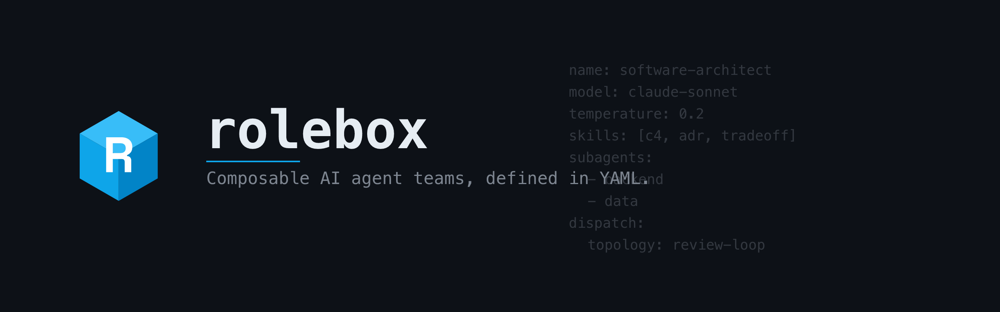
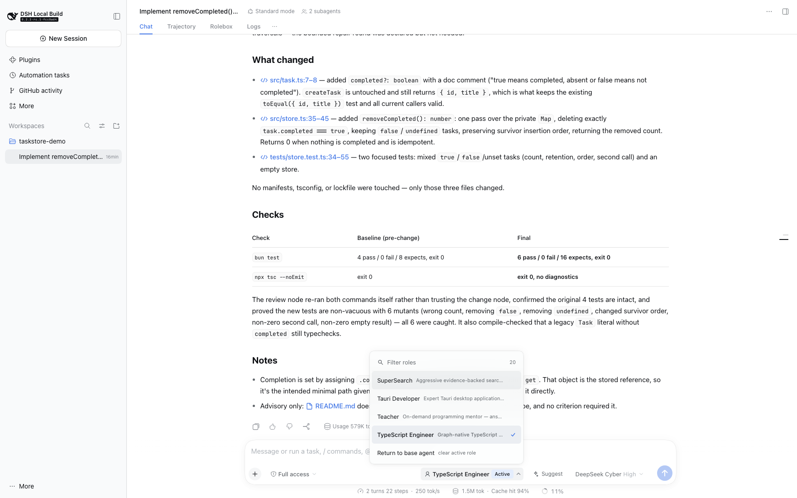
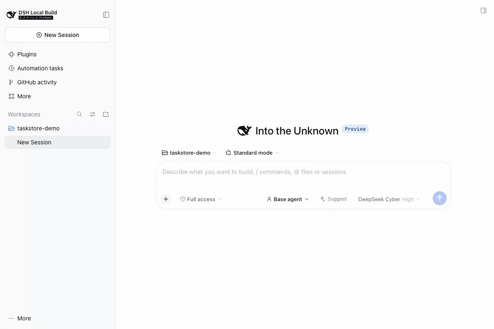
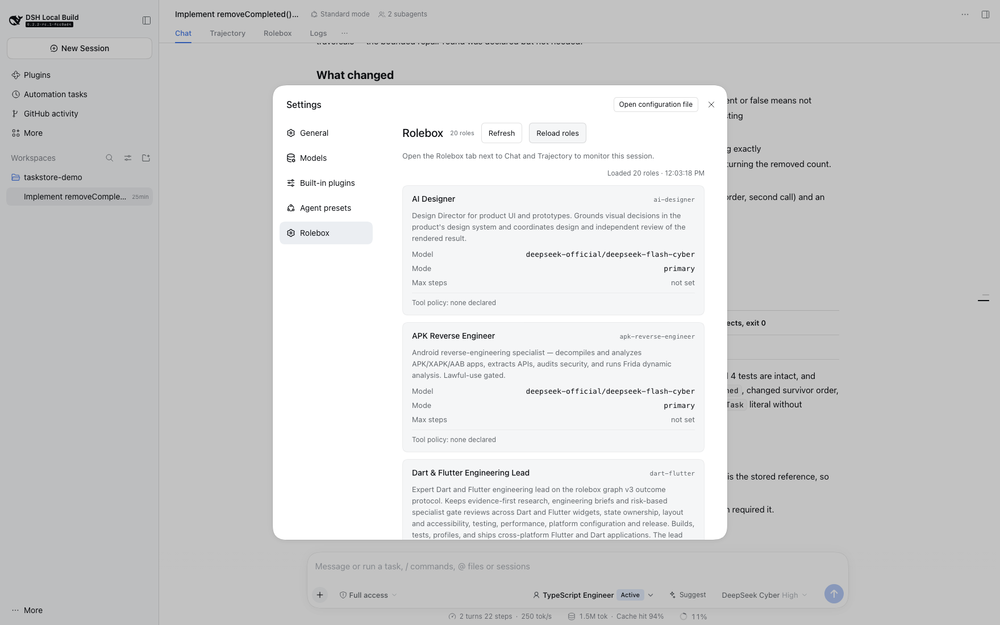
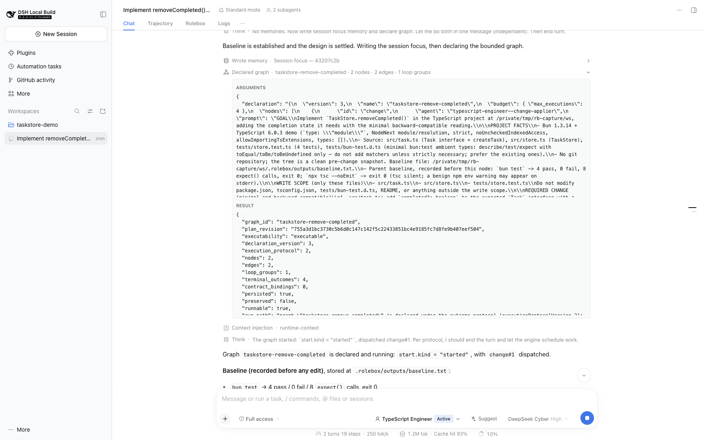
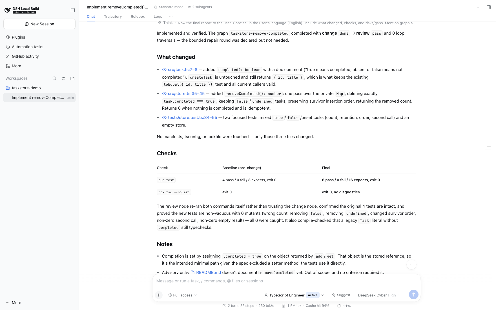
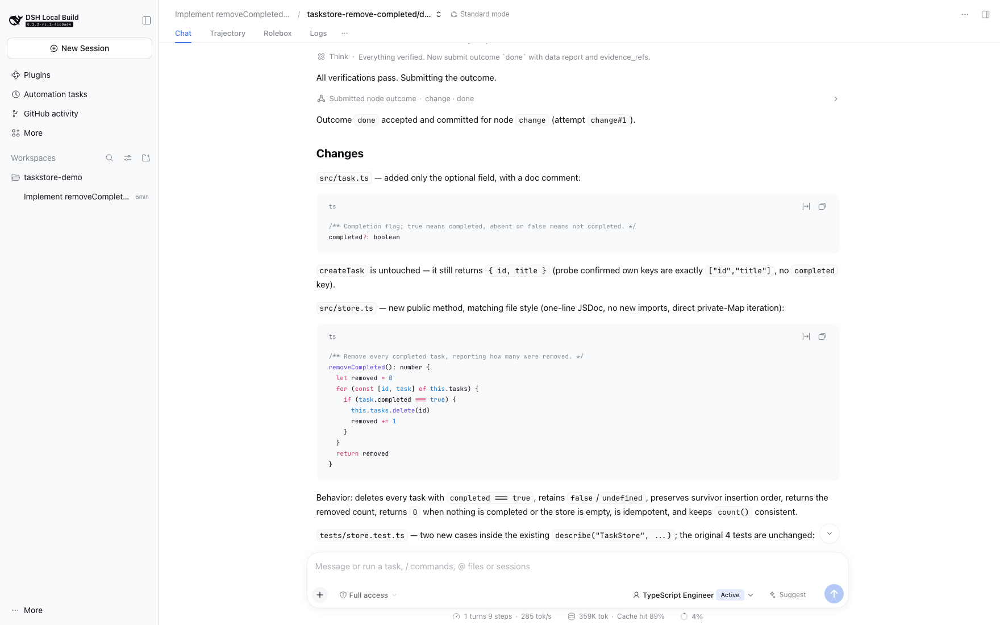
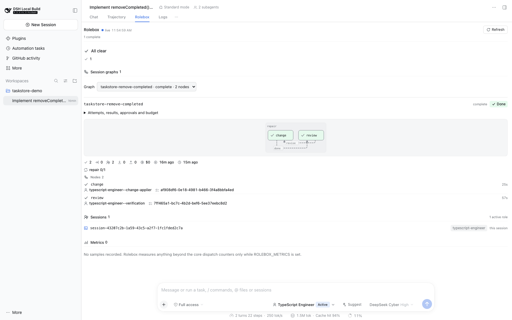
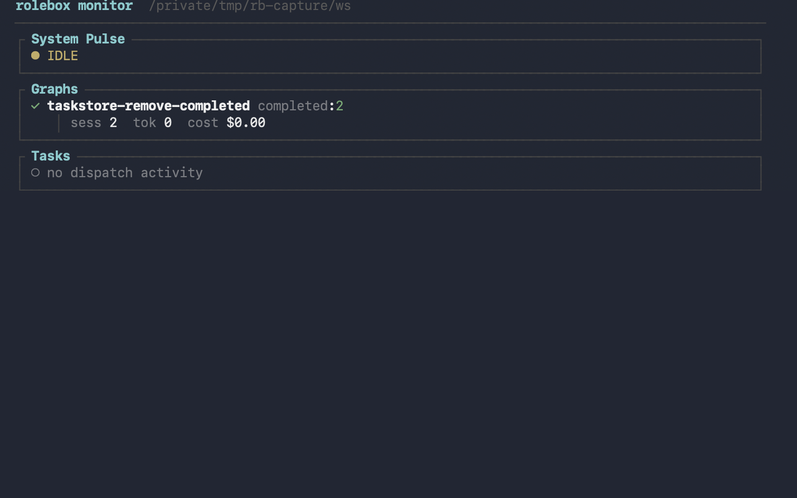
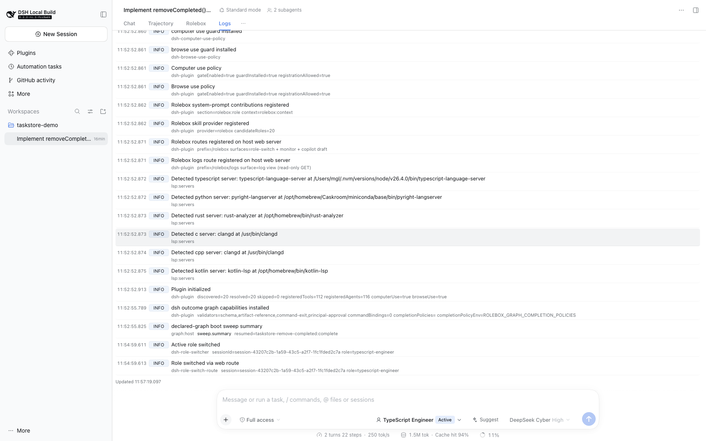

<p align="center">
  
</p>

# rolebox

<p align="center">
  <strong>Turn one coding agent into a configured engineering team.</strong><br>
  Specialist YAML roles with their own prompts, models, skills and permissions — run as explicit
  graphs, with memory that survives the session.
</p>

<p align="center">
  One plugin for <a href="https://github.com/sst/opencode">opencode</a>, <a href="https://pi.dev">pi</a>, <a href="https://www.npmjs.com/package/@deepseek-ai/dsh">dsh</a> and <a href="docs/codex.md">Codex</a>.
</p>

<p align="center">
  <a href="https://www.npmjs.com/package/rolebox"></a>
  <a href="docs/compatibility.md#harness-versions"></a>
  <a href="https://github.com/EricMoin/rolebox/actions/workflows/ci.yml"></a>
  <a href="https://github.com/EricMoin/rolebox"></a>
  <a href="https://www.npmjs.com/package/rolebox"></a>
  <a href="LICENSE"></a>
</p>

<p align="center">
  
</p>

<p align="center">
  <em>The role switcher in the composer tool row, left of the model selector: the chip names the active role and carries an <code>Active</code> marker; its list opens upward, and <code>Filter roles</code> searches the 20 loaded roles. Here <code>TypeScript Engineer</code> is active and checked.</em>
</p>

<p align="center">
  
</p>

<p align="center">
  <em>Switching roles from the composer: the chip opens its list upward, typing <code>typescript</code> narrows the 20 loaded roles to 3, and selecting <code>TypeScript Engineer</code> sets the chip to that name with an <code>Active</code> marker while the model seat collapses to the role-pinned indicator. Playback is 1×; the clip is trimmed to 1.9–14.1 s of a 15 s recording and ends on a 2 s hold.</em>
</p>

<p align="center">
  <a href="#what-it-is">What it is</a> ·
  <a href="#see-it-work">See it work</a> ·
  <a href="#install">Install</a> ·
  <a href="#roles">Roles</a> ·
  <a href="#what-you-get">What you get</a> ·
  <a href="#how-the-team-runs">Engine</a> ·
  <a href="#cli">CLI</a> ·
  <a href="#docs">Docs</a>
</p>

---

## What it is

A general coding agent is one agent with one prompt. rolebox turns it into *your* configured team: specialists defined in YAML, each with its own prompt, model, skills and permissions, working the same task together. What they learn survives the session — decisions, conventions and lessons persist in memory and come back at the next session start.

On DSH, roles can collaborate through [persistent peer teams](docs/team-work.md): invite complementary specialists, exchange events, claim tasks, and continue work across turns. Team execution on other hosts is deferred. Structured workflows use **declared** graphs: `graph_declare` names each node's agent, brief, and permitted outcomes; the host dispatches entry nodes and workers settle them with `graph_submit_outcome`. Graph nodes advance only through accepted outcomes, with bounded loops and inspectable state.

**At a glance**

- **Roles** — 18 specialists on the public [oh-my-role registry](https://github.com/EricMoin/oh-my-role), or write your own in one YAML file.
- **Runtime** — the graph v3 outcome protocol: declared nodes and edges, accepted outcomes, bounded repair loops.
- **Memory** — SQLite + FTS5, auto-injected at session start and searchable from the CLI.
- **Tools** — 32 `lsp_*` language-server tools, `hashline_*` edits anchored to content hashes, skills, references, custom functions and hooks.
- **Desktop** — a 13-tool `computer_*` family: `computer_screenshot`, `computer_windows`, `computer_displays`, `computer_focus`, `computer_click`, `computer_move`, `computer_scroll`, `computer_drag`, `computer_type`, `computer_key`, `computer_status`, `computer_permissions`, `computer_record`.
- **Browser** — a [24-tool `browse_*` family](docs/browser-use.md) for semantic web-page automation: `browse_status`, `browse_open`, `browse_snapshot`, `browse_read`, `browse_click`, `browse_drag`, `browse_type`, `browse_press`, `browse_select`, `browse_hover`, `browse_scroll`, `browse_wait`, `browse_eval`, `browse_screenshot`, `browse_record`, `browse_upload`, `browse_downloads`, `browse_dialog`, `browse_tabs`, `browse_history`, `browse_console`, `browse_network`, `browse_cookies`, `browse_close`. Gated by `browseUse`; actions need the optional Playwright peer (`npm install playwright`, then `npx playwright install chromium`).
- **Visibility** — the dsh Rolebox and Logs conversation views, the `rolebox monitor` TUI, and channel-filtered logs.

---

## See it work

Every screenshot and the role-switch clip in this README was captured from a live dsh session on a demo workspace. Each caption states only what that capture shows.

### 1 · Every loaded role, on one page

<p align="center">
  
</p>

<p align="center">
  <em>Settings → Rolebox: the 20 roles that loaded, each with its slug, description and declared tool policy.</em>
</p>

Each card carries the display name, the slug at the right (`ai-designer`, `apk-reverse-engineer`, `dart-flutter` in the capture), a description paragraph, then three label/value rows — **Model**, **Mode**, **Max steps** — and a `Tool policy:` footer. In this capture every visible card reads Model `deepseek-official/deepseek-flash-cyber`, Mode `primary`, Max steps `not set` and `Tool policy: none declared`; **no card names a source or origin path**. The header carries the `20 roles` badge, the `Refresh` and `Reload roles` buttons, and a `Loaded 20 roles · <time>` line recording when the load happened; the page points readers to the Rolebox conversation tab for monitoring, because monitoring is a conversation view, not a settings page.

### 2 · Work is declared as a graph, not prompted node by node

<p align="center">
  
</p>

<p align="center">
  <em>The TypeScript Engineer declares the work with <code>graph_declare</code>; the expanded row shows the two-node declaration and its result.</em>
</p>

The role does not do the work inline. It inspects the repo and records a baseline before editing — `bun test` → 4 pass / 0 fail / 8 expect() calls, exit 0; `npx tsc --noEmit` → exit 0 — then names one real design point: `Task` has no completion state at all, so `removeCompleted()` needs one. It takes the minimal, backward-compatible reading — an optional `completed?: boolean` on `Task` plus `removeCompleted(): number` returning the removed count — and passes that decision to the worker explicitly.

It then declares `graph_declare · taskstore-remove-completed` and yields the turn so the engine can schedule it. The declaration records `max_executions: 4` and names exactly two nodes and one bounded repair round:

- **`change`** (`change-applier`) — implement `removeCompleted(): number` in `src/store.ts`, add the optional `completed?: boolean` field to `Task` in `src/task.ts`, add a focused test in `tests/store.test.ts`, and run the sample project’s test command and `tsc --noEmit`.
- **`review`** (`verification`, independent) — read the actual files and re-run both checks against the same baseline.

The turn closes with the declaration started: `start.kind: "started"`, `persisted: true`, `runnable: true`, and `change#1` dispatched.

### 3 · Independent verification, then reconciliation

<p align="center">
  
</p>

<p align="center">
  <em>Accepted results come back; the parent reconciles them, re-runs both checks itself, and records what changed and what is advisory.</em>
</p>

Both nodes ran in their own sessions, and the verifying node is not the node that wrote the code. The closing synthesis names three changed files and no manifests, tsconfig or lockfile: `src/task.ts:7-8` adds the optional field, `src/store.ts:35-45` adds `removeCompleted(): number`, and `tests/store.test.ts:34-55` adds two focused tests — a mixed `true`/`false`/unset store (count, retention, order and a second call) and an empty store.

A `Checks` table sets each check against its baseline: `bun test` went from `4 pass / 0 fail / 8 expect() calls, exit 0` to `6 pass / 0 fail / 16 expect() calls, exit 0`, and `npx tsc --noEmit` stayed at `exit 0` with no diagnostics. The review node re-ran both commands itself, confirmed the original four tests were intact, and proved the new tests non-vacuous by catching all 6 mutants (wrong count, removing `false`, removing `undefined`, changed survivor order, a non-zero second call and a non-zero empty-store result); it also compile-checked that a legacy `Task` literal without `completed` still typechecks. The parent re-ran both required commands after the reviewers settled.

The closing `Notes` section records two points: completion is set by assigning `.completed = true` on the object returned by `add` / `get`, which is the stored reference and therefore the intended minimal path for a spec that excluded a setter method; and `README.md` does not document `removeCompleted`, which was judged out of scope and required by no acceptance criterion. The declaration also records that the workspace has no git repository, so scope was confirmed from the file inventory plus the pre-change baseline rather than a machine diff.

### 4 · One brief in, one outcome out

<p align="center">
  
</p>

<p align="center">
  <em>One brief in, one outcome out: the worker makes the scoped edits, runs both checks, and settles node <code>change</code> with the <code>done</code> outcome.</em>
</p>

The capture shows a dsh worker closing its assigned brief with `graph_submit_outcome`: "All verifications pass. Submitting the outcome.", the `Submitted node outcome · change · done` row, and "Outcome done accepted and committed for node change (attempt change#1)." Current workers use the host's native command and file tools. Workers inherit the parent’s authorized task tools with native schemas exposed by default. Node tool lists do not restrict them; discovery and code presentation remain optional; see [Worker tools](docs/worker-tools.md). Workers cannot read or steer graph state. Under `Changes`, the worker shows the optional `completed?: boolean` field with its doc comment, the `removeCompleted()` implementation, a behavior summary (deletes every task with `completed === true`, retains `false` / `undefined`, preserves survivor insertion order, returns the removed count, returns `0` when nothing is completed or the store is empty, is idempotent and keeps `count()` consistent) and the `tests/store.test.ts` intro line. Its own report records `6 pass / 0 fail / 16 expect() calls` and `npx tsc --noEmit` exit 0 with no diagnostics, plus an extra probe at exit 0.

### 5 · Watch the engine while it runs

<p align="center">
  
</p>

<p align="center">
  <em>The Rolebox view: the session's selected graph, each node's agent and duration, the repair counter and the budget expander.</em>
</p>

The Rolebox view is the session's engine view: it is a conversation view beside Chat, Trajectory and Logs, and it follows the session whose evidence it shows. In the capture it reports `1 complete`, the graph picker selected `taskstore-remove-completed · complete · 2 nodes`, and `Session graphs 1`. The selected graph shows `repair 0/1`, an expander for attempts, results, approvals and budget, and `Nodes 2`: `change` ran `typescript-engineer--change-applier` in 25s and `review` ran `typescript-engineer--verification` in 57s. `Sessions 1 · 1 active role` lists the viewed session as `typescript-engineer · this session`. `Metrics 0` reports `No samples recorded` and says the view measures anything beyond the core dispatch counters only while `ROLEBOX_METRICS` is set.

### 6 · The same run from a terminal

<p align="center">
  
</p>

<p align="center">
  <em>The same run from the terminal: <code>rolebox monitor</code> as System Pulse, Graphs and Tasks panes.</em>
</p>

`rolebox monitor` renders the project's persisted dispatch state as a dashboard of boxed panes under a header naming the command and the workspace it read. At capture time **System Pulse** reads `IDLE`; **Graphs** lists `taskstore-remove-completed  completed: 2` with `sess 2  tok 0  cost $0.00` beneath it; and **Tasks** reports `no dispatch activity`.

### 7 · Logs, filtered by channel and by session

<p align="center">
  
</p>

<p align="center">
  <em>Plugin startup, LSP discovery, graph-host boot and the role switch, one record per event, filterable by channel or by session.</em>
</p>

The Logs view is a conversation view beside Chat, Trajectory and Rolebox, and it polls the workspace's `.rolebox/logs` directory (`records 144`, `skipped 0` in this run), rendering one line per record: timestamp, level, title, channel and details. The records in this capture are all INFO: the computer-use and browse-use gates from `dsh-computer-use-policy` / `dsh-browse-use-policy`; `dsh-plugin` lines for the computer-use and browse-use policies, the system-prompt contribution, the skill provider (`candidateRoles=20`), the route registration (`prefix=/rolebox surfaces=role-switch + monitor + copilot draft`), the logs route and `Plugin initialized — discovered=20 resolved=20 skipped=0 registeredTools=112 registeredAgents=116 computerUse=true browseUse=true`; `lsp-servers` lines detecting the TypeScript, Python, Rust, C, C++ and Kotlin servers; `graph-host` lines for "dsh outcome graph capabilities installed" and the declared-graph boot sweep `resumed=taskstore-remove-completed:complete`; and the `dsh-role-switcher` / `dsh-role-switch-route` pair recording `role=typescript-engineer`. The controls are an `All channels` dropdown, a `This session` filter, `Pause` and `Refresh`. The view and `rolebox logs` read the same log files, so what ran in the UI is debuggable from a shell.

### Loop mode

**Loop mode** runs the same task across N rounds, each dispatched to its own fresh session. `|loop:3|` seeds every round with the previous round's summary (`inherit`, the default); `|loop:3,fresh|` starts each round from a clean slate. The parser (`src/loop/params.ts`) also accepts `on`/`true` for inherit and `no-inherit`/`off`/`false` for fresh, and clamps N to a hard cap of 50. Useful for refinement passes, batch fixes and self-correcting workflows.

**Also in the box**, reachable from the same session: persistent memory (`rolebox memory`), skills and references, `LINE#HASH`-anchored `hashline_*` editing, MCP servers, custom hooks, composer draft suggestions, and rolebox's own [computer-use family](docs/computer-use.md).

---

## Install

Rolebox's CLI and development tools require Node.js 26.4+ and npm. For a source checkout, run `npm ci`, `npm run build`, and module-scoped tests with `npm test -- tests/<module>/`. See [Node runtime and development](docs/node-runtime.md) and [Repository structure](docs/project-structure.md). The TUI additionally needs Node's `--experimental-ffi` flag; the test command supplies it.

rolebox runs on four harnesses. A `rolebox/` directory in the **current working directory** takes precedence over the global roles directory; registry roles install with `rolebox install <name>` and deploy with `rolebox sync <opencode|pi|dsh|codex>`. Each harness has a minimum version — [Harness versions](docs/compatibility.md#harness-versions) lists them and why.

| Harness | Config directory | Roles directory | Global skills | Env override |
|---|---|---|---|---|
| [opencode](https://github.com/sst/opencode) | `~/.config/opencode` | `~/.config/opencode/rolebox` | `~/.config/opencode/skills` | `XDG_CONFIG_HOME` |
| [pi](https://pi.dev) | `~/.pi/agent` | `~/.pi/agent/rolebox` | `~/.pi/agent/skills` | `PI_CODING_AGENT_DIR` |
| [dsh](https://www.npmjs.com/package/@deepseek-ai/dsh) | `~/.dsh` | `~/.dsh/rolebox` | `~/.dsh/skills` | `DSH_HOME` |
| [Codex](docs/codex.md) | `~/.codex` | `~/.codex/rolebox` | `~/.codex/skills` | `CODEX_HOME` |

### opencode

```bash
cd ~/.config/opencode && npm install rolebox
mkdir -p ~/.config/opencode/rolebox && cd ~/.config/opencode/rolebox && rolebox init my-agent -y
```

```jsonc
// ~/.config/opencode/opencode.jsonc
{ "plugin": ["rolebox"] }
```

opencode 1.x loads the package root (`{ id, server }`); opencode v2 resolves the same installed package through its plugin entrypoint `rolebox/server` (`{ id, setup }`, `src/entries/opencode2.ts`) instead, so no second package or extra install step is needed. What v2 registers — and every surface where it degrades — is listed in [compatibility.md](docs/compatibility.md#opencode-v2).

### pi

```bash
pi install npm:rolebox     # project-local instead: pi install -l npm:rolebox
mkdir -p ~/.pi/agent/rolebox && cd ~/.pi/agent/rolebox && rolebox init my-agent -y
# from a checkout instead: add "extensions": ["/path/to/rolebox/dist/entries/pi.js"] to ~/.pi/agent/settings.json
```

### dsh

```bash
dsh plugin --profile <name> add rolebox    # installs the bundle into that profile
dsh plugin --profile web add rolebox       # installs the bundle into the web profile
mkdir -p ~/.dsh/rolebox && cd ~/.dsh/rolebox && rolebox init my-agent -y   # $DSH_HOME/rolebox if set
```

Restart the harness. A non-bundle dsh install instead needs one `- insert:` row naming the profile-relative `./node_modules/rolebox/dist/entries/dsh.js` in the profile's `cordis.patch.yml` — see [examples/dsh/cordis.patch.yml](examples/dsh/cordis.patch.yml). Profile patch semantics, the web role-switch dock, and the `/rolebox` REST surface are documented in [docs/dsh-plugin-contract.md](docs/dsh-plugin-contract.md).

DSH exposes all 32 `lsp_*` tools by default. Install the appropriate language
server on the host's `PATH`; an explicit `enabledNamespaces` allow-list must
include `lsp`. Start with `lsp_servers`, then call `lsp_diagnostics` on an absolute
project file path. See [LSP setup and usage](skills/rolebox-config/references/runtime.md#lsp)
for workspace scope, server binaries and tool behavior.

### Codex

```bash
npm install -g rolebox     # or run from a checkout built with `npm run build`
rolebox sync codex
codex plugin add rolebox@rolebox
```

`rolebox sync codex` registers a local plugin marketplace, deploys installed roles,
and generates public native agents under `$CODEX_HOME/agents` (`~/.codex/agents` by
default). Restart Codex, then ask it to delegate using a generated agent such as
`rolebox--reviewer`.
Private children remain scoped graph targets. The MCP runtime exposes 30 base tools,
including native session browsing and declared-graph execution, plus optional desktop
and browser families. Delegated workers require Codex's host-supplied sandbox metadata
and use native Codex tools inside that sandbox. After declaring a graph, inspect
`parent_notification.available`: a verified shared app-server can wake the parent
after its turn ends. Otherwise, use `graph_wait` as the fallback instead of polling
`graph_status`. An external UI-owned stdio conversation needs its own host connection
before background notifications can wake it.
Details and supported boundaries: [docs/codex.md](docs/codex.md).

<details>
<summary><strong>Deprecated entry paths</strong></summary>

The former `dist/index.js`, `dist/pi-extension.js`, and `dist/dsh-plugin.js` artifacts still resolve as generated re-export aliases, but they are deprecated — new checkouts and profile rows should use the canonical `dist/entries/*.js` paths instead.

</details>

---

## Roles

Eighteen roles are published on the [oh-my-role registry](https://github.com/EricMoin/oh-my-role). `rolebox install <name>` fetches one, `rolebox sync <harness>` deploys it, and `rolebox init` scaffolds your own.

| Role | What it does |
|---|---|
| **emperor** | Top-level orchestrator — triages the request, dispatches planner/executor subtrees, synthesises results with closed-loop validation. Never writes code itself. |
| **software-architecture** | Architecture orchestrator — design, review, ADRs, migration plans, and architecture-shaping implementation through specialist subagents. |
| **ai-designer** | Design director — tiered routing, artifact-first output, severity-layered quality gates. |
| **typescript-engineer** | Graph-native TypeScript engineer — type modelling, runtime debugging, API design, module packaging, workspace builds. |
| **react-frontend** | React/Next.js developer — component architecture, hooks, state, Tailwind, data fetching, accessibility, TDD. |
| **dart-flutter** | Dart & Flutter engineering lead — evidence-first research, engineering briefs, risk-based specialist gates. |
| **jetpack-compose** | Jetpack Compose and Android lead — invariant-driven design, encapsulation-preserving tests, AOSP/AndroidX source tracing. |
| **rust-engineer** | Rust lead — complexity-tier routing with safety, async, API, performance and platform gates. |
| **tauri** | Tauri desktop developer — IPC, plugins, permissions, system tray, window customisation, testing. |
| **git-master** | Git operations specialist — working tree, commits, branches, merge/rebase, stash, tags, history, undo, worktrees. Safe by default. |
| **apk-reverse-engineer** | Android reverse engineering — decompile APK/XAPK/AAB, extract APIs, audit security, run Frida dynamic analysis. Lawful-use gated. |
| **oss-finder** | Open-source research — finds, source-traces, evaluates and recommends implementations with evidence. |
| **supersearch** | Search specialist — triangulates local files, code, git history, web, GitHub and official docs. |
| **teacher** | On-demand programming mentor — conceptual answers, idiomatic patterns, code critique, library internals. |
| **comment-writer** | Comment specialist — writes, rewrites and reviews comments; explains WHY, not WHAT. |
| **role-creator** | Meta-role — interviews you, scaffolds a new role, then verifies it through four tiers. |
| **rolebox-tester** | Functional tester for rolebox itself — runs chosen test modules on demand, or the full suite. |
| **deepseek-whale-girl** | A tsundere whale-girl companion persona that is still a fully capable coding assistant. 🐋 |

A role is a directory: `role.yaml` (name, model, mode, permissions, subagents, skills), its prompts, and its assets. Start with [create-a-role.md](docs/create-a-role.md) and the [role.yaml reference](docs/role-yaml.md).

---

## What you get

| | Default single agent | With rolebox |
|---|---|---|
| **Who does the work** | One prompt for every task | Specialists with their own prompt, model, skills and permissions |
| **Remembering** | Sessions start blank | SQLite + FTS5 memory, auto-injected at session start |
| **Switching** | Reconfigure and restart | Switch role in place; the transcript survives |
| **Concurrency** | One agent at a time | Parallel dispatched workers with engine-managed limits |
| **Autonomy** | Free-form chat | Declared graphs with accepted outcomes and bounded repair loops |
| **Code navigation** | Text search | 32 `lsp_*` tools — definition, references, rename, diagnostics, call hierarchy |
| **Editing** | Line numbers that drift | `hashline_*` edits anchored to `LINE#HASH` content hashes |
| **Observability** | Whatever the host logs | Rolebox and Logs conversation views, `rolebox monitor` TUI, channel-filtered logs |
| **Desktop** | None | [13-tool computer-use family](docs/computer-use.md): screenshot, windows, displays, focus, click, move, scroll, drag, type, key, status, permissions, record |
| **Iterating** | Restart to pick up changes | Edit YAML, hot-reload the asset |

---

## How the team runs

For complementary specialties, [role teams on DSH](docs/team-work.md) provide persistent membership, an ordered event stream, exclusive task claims, and automatic peer wakeups. Members use independent agent sessions with their own role configuration; private child roles stay within their owning role. Team execution on OpenCode, Pi, and Codex is deferred.

For structured workflows, `graph_declare` writes a version-3 declaration — each node's agent, brief and the outcomes it may report, plus the edges that route an accepted outcome — and reports persistence separately from the host's initial start decision. The host dispatches the entry nodes; a worker settles its node with `graph_submit_outcome`, which commits the node's state and arms the next node.

`graph_control` applies the trusted lifecycle commands (failure, timeout, cancel, retry, `budget-stop`, and approval requests with their decisions); `graph_status` reads the recorded state back; `graph_audit` inventories the persisted store. Loops live in declared loop groups with a traversal cap, so a repair can repeat but never forever.

Architecture and the full toolset: [graph-outcome-protocol.md](docs/graph-outcome-protocol.md) · operations: [graph-v3-operations.md](docs/graph-v3-operations.md) · internals: [graph-engine-architecture.md](docs/graph-engine-architecture.md).

---

## CLI

| Command | Description |
|---|---|
| `rolebox init <name>` | Scaffold a new role directory |
| `rolebox install [name]` | Install a role from a registry (picker when omitted) |
| `rolebox uninstall [name]` | Remove an installed role |
| `rolebox update [name]` | Update an installed role to the registry version |
| `rolebox list` | Show installed roles |
| `rolebox search <query>` | Search the configured registries |
| `rolebox registry` | Configured role sources: `add`, `remove`, `list`, `default` |
| `rolebox status` | Overall health and harness integration |
| `rolebox info [name]` | Inspect one installed role in detail (picker when omitted) |
| `rolebox sync <target>` | Deploy installed roles to `opencode` / `pi` / `dsh` / `codex` |
| `rolebox config [name]` | Configure models for a role and its subagents (`--target` selects the harness) |
| `rolebox bench <subcommand>` | Local dsh role benchmarks: `init`, `validate`, `doctor`, `run`, `watch`, `report`, `baseline`, `compare` |
| `rolebox monitor` | Runtime dashboard for a project's persisted dispatch state (TUI, `--json`, Prometheus export) |
| `rolebox logs` | Query, follow and prune the rolebox log files (`logs files`, `logs prune`) |
| `rolebox memory` | Manage the rolebox memory store (`list`, `show`, `search`, `delete`, `export`, `clean`, `stats`) |
| `rolebox checkpoint` | Manage dispatch checkpoints (`list`, `clean`) |
| `rolebox mcp` | Run the rolebox MCP server on stdio (Codex integration) |
| `rolebox host <harness> <connection> <action>` | Harness host connections and IPC adapters; currently `codex desktop` |
| `rolebox host codex desktop probe --binding <file>` | Probe the original Codex desktop MCP through an explicit IPC binding (experimental, Unix) |
| `rolebox host codex desktop prepare --config <file> --output <path>` | Prepare a desktop-owned shared Codex launcher (experimental, Unix) |

Full flags and examples: [cli.md](docs/cli.md). Build a suite with [Benchmarks on dsh](docs/benchmarks.md): response/file assertions, trusted local command checks, a `code-fix` template, independent trials, feedback against a saved baseline after role edits, and offline JSON/HTML results with file-change evidence.

---

## Model aliases

Registry roles ship placeholder model names, because a role should not be hard-coded to one provider. Map them once in `role_config.yaml` — `~/.config/opencode/role_config.yaml`, `~/.pi/agent/role_config.yaml`, `~/.dsh/role_config.yaml`, or `~/.codex/role_config.yaml` (the harness config directory):

```yaml
model_aliases:
  provider/tier-1-flagship: your-provider/your-strongest-model
  provider/tier-2-reasoning: your-provider/your-reasoning-model
  provider/tier-3-fast: your-provider/your-fast-model
```

Unrecognized values pass through unchanged with a warning. Full resolution chain, error handling and hot-reload: [model-aliases.md](docs/model-aliases.md).

---

## Docs

**Concepts**

| | | |
|---|---|---|
| [Graph outcome protocol](docs/graph-outcome-protocol.md) | [Graph v3 operations](docs/graph-v3-operations.md) | [Graph engine architecture](docs/graph-engine-architecture.md) |
| [Memory usage](docs/memory.md) | [Session tools](docs/session-tools-strategy.md) | [Copilot suggestions and continuation](docs/copilot.md) |
| [Functions](docs/functions.md) | [Hooks](docs/hooks.md) | [Extensions](docs/extensions.md) |

**Build a role**

| | | |
|---|---|---|
| [Create a role](docs/create-a-role.md) | [role.yaml reference](docs/role-yaml.md) | [Directory structure](docs/directory-structure.md) |
| [Skills](docs/skills.md) | [References](docs/references.md) | [Subagents](docs/subagents.md) |
| [Registry](docs/registry.md) | [Model aliases](docs/model-aliases.md) | [Benchmarks on dsh](docs/benchmarks.md) |

**Harnesses**

| | | |
|---|---|---|
| [Compatibility matrix](docs/compatibility.md) | [dsh plugin contract](docs/dsh-plugin-contract.md) | [dsh provider notes](docs/dsh-provider-notes.md) |
| [Codex](docs/codex.md) | [Computer use](docs/computer-use.md) | [Limitations](docs/limitations.md) |

**Operations**

| | | |
|---|---|---|
| [CLI](docs/cli.md) | [Dispatch config](docs/dispatch-config.md) | [Error handling](docs/error-handling.md) |
| [Logging](docs/logging.md) | [Logging architecture](docs/logging-architecture.md) | [Install/update audit](docs/audit-install-update-platform.md) |
| [CLI output audit](docs/audit-progress-ui.md) | | |

---

> **Upgrading from 0.x or 1.x?** rolebox 2.x (`package.json` currently reads `2.5.0`) runs work through the **graph outcome protocol**: `graph_declare` persists a version-3 declaration, and a node advances only through an outcome its worker submits with `graph_submit_outcome`. An existing (legacy) declaration must be rewritten for the version-3 grammar and started as a new run. A persisted legacy state body stays readable but is never advanced, and this protocol has no incremental node or edge construction tool. See [docs/graph-outcome-protocol.md](docs/graph-outcome-protocol.md).

---

## Contributing

Contributions welcome — see [CONTRIBUTING.md](CONTRIBUTING.md). The test layout, per-module slices and repository conventions are in [AGENTS.md](AGENTS.md).

---

## License

MIT &mdash; see the [LICENSE](LICENSE) file.
