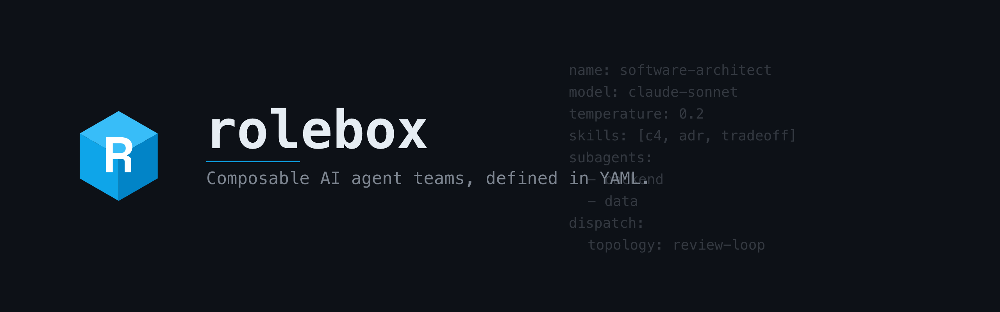
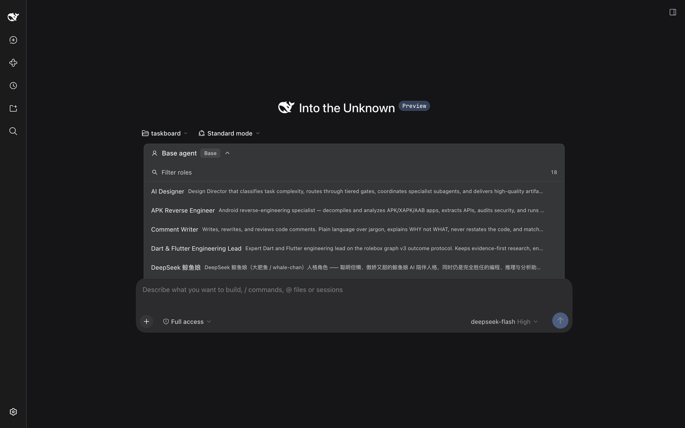
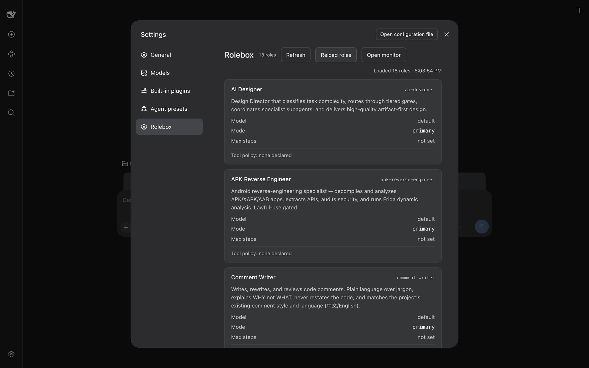
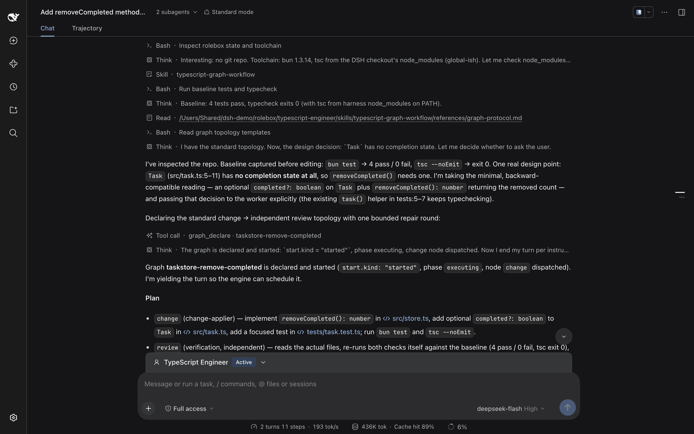
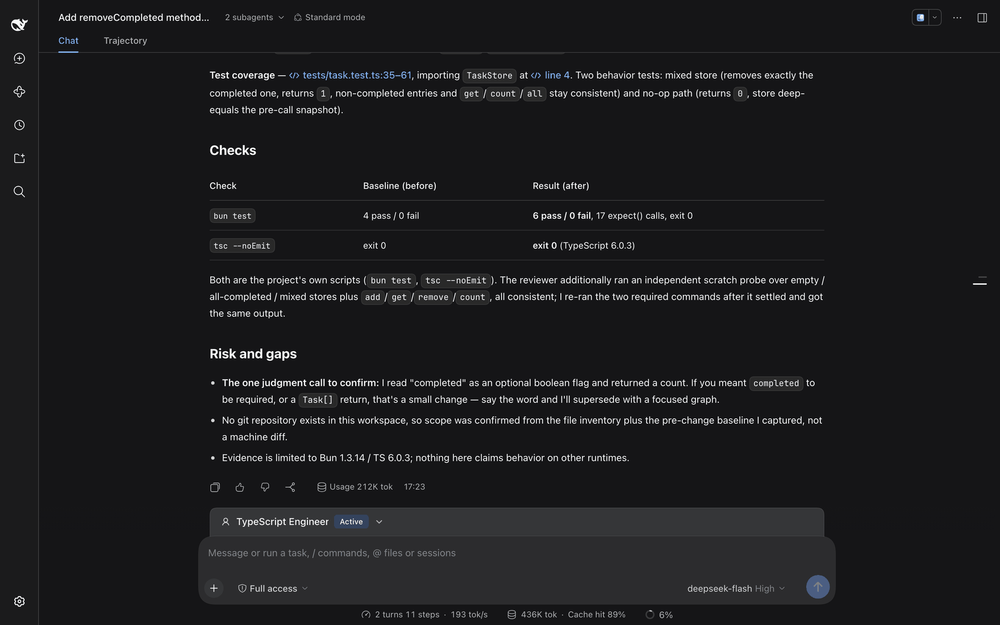
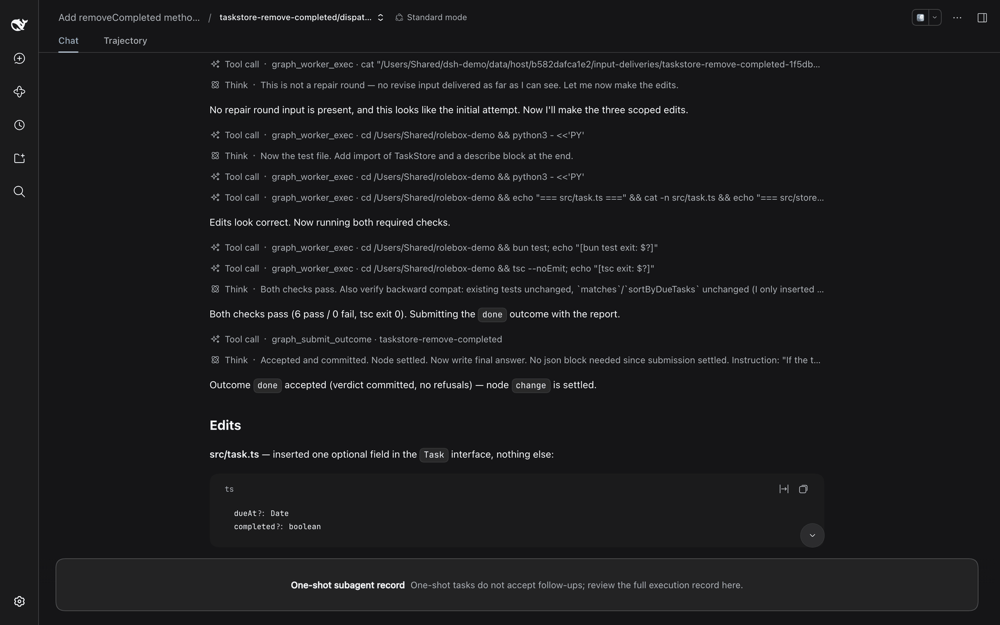
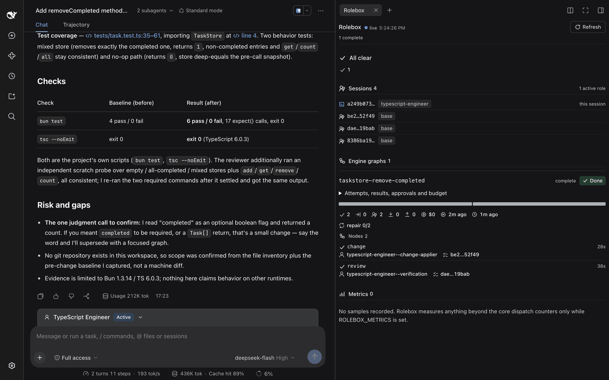
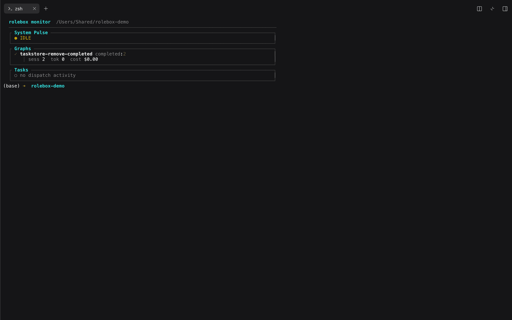
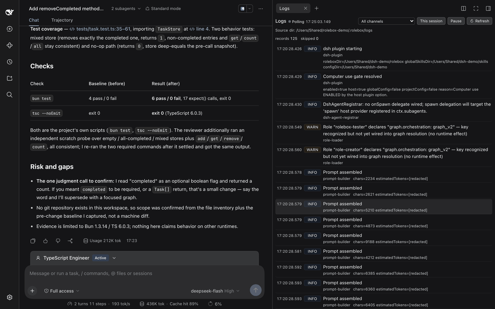

<p align="center">
  
</p>

# rolebox

<p align="center">
  <strong>Turn one coding agent into a configured engineering team.</strong><br>
  Specialist YAML roles with their own prompts, models, skills and permissions — run as explicit
  graphs, with memory that survives the session.
</p>

<p align="center">
  One plugin for <a href="https://github.com/sst/opencode">opencode</a>, <a href="https://pi.dev">pi</a>, <a href="https://www.npmjs.com/package/@deepseek-ai/dsh">dsh</a> and <a href="docs/codex.md">Codex</a>.
</p>

<p align="center">
  <a href="https://www.npmjs.com/package/rolebox"></a>
  <a href="docs/compatibility.md#harness-versions"></a>
  <a href="https://github.com/EricMoin/rolebox/actions/workflows/ci.yml"></a>
  <a href="https://github.com/EricMoin/rolebox"></a>
  <a href="https://www.npmjs.com/package/rolebox"></a>
  <a href="LICENSE"></a>
</p>

<p align="center">
  
</p>

<p align="center">
  <em>The role picker, opened from the composer: <code>Filter roles</code> searches the 18 loaded roles, each row a display name and a one-line description, and the header names the current selection, <code>Base agent</code>.</em>
</p>

<p align="center">
  <a href="#what-it-is">What it is</a> ·
  <a href="#see-it-work">See it work</a> ·
  <a href="#install">Install</a> ·
  <a href="#roles">Roles</a> ·
  <a href="#what-you-get">What you get</a> ·
  <a href="#how-the-team-runs">Engine</a> ·
  <a href="#cli">CLI</a> ·
  <a href="#docs">Docs</a>
</p>

---

## What it is

A general coding agent is one agent with one prompt. rolebox turns it into *your* configured team: specialists defined in YAML, each with its own prompt, model, skills and permissions, working the same task together. What they learn survives the session — decisions, conventions and lessons persist in memory and come back at the next session start.

The team is not a prompt chain. Work is **declared**: `graph_declare` writes a version-3 declaration naming each node's agent, its brief, and the outcomes it may report; the host dispatches the entry nodes and a worker settles its node with `graph_submit_outcome`. A node advances only through an accepted outcome — a free-form report is never read as progress. Loops are bounded and declared, and every step is inspectable while it runs.

**At a glance**

- **Roles** — 18 specialists on the public [oh-my-role registry](https://github.com/EricMoin/oh-my-role), or write your own in one YAML file.
- **Runtime** — the graph v3 outcome protocol: declared nodes and edges, accepted outcomes, bounded repair loops.
- **Memory** — SQLite + FTS5, auto-injected at session start and searchable from the CLI.
- **Tools** — 32 `lsp_*` language-server tools, `hashline_*` edits anchored to content hashes, skills, references, custom functions and hooks.
- **Desktop** — a 12-tool `computer_*` family: `computer_screenshot`, `computer_windows`, `computer_displays`, `computer_focus`, `computer_click`, `computer_move`, `computer_scroll`, `computer_drag`, `computer_type`, `computer_key`, `computer_status`, `computer_permissions`.
- **Visibility** — the dsh Rolebox monitor pane, the `rolebox monitor` TUI, and channel-filtered logs.

---

## See it work

Every screenshot in this README was captured from a live dsh session on a demo workspace. Each caption states only what that capture shows.

### 1 · Every loaded role, on one page

<p align="center">
  
</p>

<p align="center">
  <em>Settings → Rolebox: the 18 roles that loaded, each with its slug, description and declared tool policy.</em>
</p>

Each card carries the display name, the slug at the right (`ai-designer`, `apk-reverse-engineer`, `comment-writer` in the capture), a description paragraph, then three label/value rows — **Model**, **Mode**, **Max steps** — and a `Tool policy:` footer. In this capture every visible card reads Model `default`, Mode `primary`, Max steps `not set` and `Tool policy: none declared`; **no card names a source or origin path**. The header carries the `18 roles` badge, the `Refresh`, `Reload roles` and `Open monitor` buttons, and a right-aligned `Loaded 18 roles · <time>` line recording when the load happened.

### 2 · Work is declared as a graph, not prompted node by node

<p align="center">
  
</p>

<p align="center">
  <em>The TypeScript Engineer loads its own skill, reads the protocol reference, and declares the work with <code>graph_declare</code>.</em>
</p>

The role does not do the work inline. It inspects the repo and records a baseline before editing — `bun test` → 4 pass / 0 fail, `tsc --noEmit` → exit 0 — then names one real design point: `Task` has no completion state at all, so `removeCompleted()` needs one. It takes the minimal, backward-compatible reading — an optional `completed?: boolean` on `Task` plus `removeCompleted(): number` returning the removed count — and passes that decision to the worker explicitly.

It then declares `graph_declare · taskstore-remove-completed` and yields the turn so the engine can schedule it. The plan names exactly two nodes and one bounded repair round:

- **`change`** (`change-applier`) — implement `removeCompleted(): number` in `src/store.ts`, add the optional `completed?: boolean` field to `Task` in `src/task.ts`, add a focused test in `tests/task.test.ts`, and run `bun test` and `tsc --noEmit`.
- **`review`** (`verification`, independent) — read the actual files and re-run both checks against the same baseline.

The turn closes on the declaration being started (`start.kind: started`, phase `executing`, node `change` dispatched). The capture states no execution budget.

### 3 · Independent verification, then reconciliation

<p align="center">
  
</p>

<p align="center">
  <em>Accepted results come back; the parent reconciles them, re-runs the checks itself, and states what was verified and what remains uncertain.</em>
</p>

Both nodes ran in their own sessions, and the verifying node is not the node that wrote the code. The closing synthesis reports the test coverage — `tests/task.test.ts:35-61`, importing `TaskStore` at line 4 — as two behavior tests: a mixed store that removes exactly the completed entry and returns `1` while non-completed entries and `get`/`count`/`all` stay consistent, and a no-op path that returns `0` with the store deep-equal to a pre-call snapshot.

A `Checks` table sets each check against its baseline: `bun test` went from `4 pass / 0 fail` to `6 pass / 0 fail, 17 expect() calls, exit 0`, and `tsc --noEmit` stayed at `exit 0` (TypeScript 6.0.3). Both are the project's own scripts; the reviewer additionally ran an independent scratch probe over empty, all-completed and mixed stores plus `add` / `get` / `remove` / `count`, and the parent re-ran the two required commands after the reviewer settled and got the same output.

The `Risk and gaps` list keeps three things open on purpose: the one judgment call still to confirm (whether `completed` should be required, or the return a `Task[]`); the fact that no git repository exists in the workspace, so scope was confirmed from the file inventory plus the pre-change baseline rather than a machine diff; and the fact that the evidence covers Bun 1.3.14 / TypeScript 6.0.3 and claims nothing about other runtimes.

### 4 · One brief in, one outcome out

<p align="center">
  
</p>

<p align="center">
  <em>One brief in, one outcome out: the worker makes the scoped edits, runs both checks, and settles node <code>change</code> with the <code>done</code> outcome.</em>
</p>

A dispatched worker is a one-shot session with exactly two tools — `graph_worker_exec` for reads, commands and permitted edits, and `graph_submit_outcome` to settle its node. It cannot dispatch, and it cannot read or steer graph state. Here the worker's whole record is `cat` of its host handoff, the scoped edits, `cat -n` verification of the edited files, `bun test` and `tsc --noEmit`. It notes that this was not a repair round (no revise input was delivered), makes the three scoped edits, reports `6 pass / 0 fail, tsc exit 0`, and closes on `Outcome done accepted (verdict committed, no refusals) — node change is settled`. The banner across the bottom is the one-shot contract: the record does not accept follow-ups.

### 5 · Watch the engine while it runs

<p align="center">
  
</p>

<p align="center">
  <em>The monitor pane: live sessions and their active role, the engine graph with each node's agent and duration, the repair counter and the run's budget expander.</em>
</p>

The Rolebox pane in dsh's right sidebar is the live engine view. In the capture it reports `Sessions 4` with one active role — the session being viewed runs `typescript-engineer`, the other three run `base` — and `Engine graphs 1`: `taskstore-remove-completed`, marked `complete` and `Done`, with an expander for attempts, results, approvals and budget, a progress bar with the run's counters, and `repair 0/2`. Under `Nodes 2`, each node names its agent, worker session and duration: `change` ran `typescript-engineer--change-applier` for 28s, `review` ran `typescript-engineer--verification` for 38s. `Metrics 0` reports `No samples recorded` and says the pane measures anything beyond the core dispatch counters only while `ROLEBOX_METRICS` is set. No loops section appears in this pane.

### 6 · The same run from a terminal

<p align="center">
  
</p>

<p align="center">
  <em>The same run from the terminal: <code>rolebox monitor</code> as System Pulse, Graphs and Tasks panes.</em>
</p>

`rolebox monitor` renders the project's persisted dispatch state as a dashboard of boxed panes under a header naming the command and the workspace it read. At capture time **System Pulse** reads `IDLE`; **Graphs** lists `taskstore-remove-completed  completed: 2` with `sess 2  tok 0  cost $0.00` beneath it; and **Tasks** reports `no dispatch activity`.

### 7 · Logs, filtered by channel and by session

<p align="center">
  
</p>

<p align="center">
  <em>Plugin startup, role loading and prompt assembly, one record per event, filterable by channel or by session.</em>
</p>

The Logs pane polls the workspace's `.rolebox/logs` directory (in the capture `records 125`, `skipped 0`) and renders one line per record: timestamp, level, title, channel and details. The records shown include the `dsh-plugin` startup lines and the computer-use gate verdict, `dsh-agent-registrar` reporting that no `onSpawn` delegate is wired, `role-loader` warnings that a role declares `graph.orchestration: graph_v2` and that the key is recognized but not wired into graph resolution, and a run of `prompt-builder` `Prompt assembled` lines with their character counts. The levels shown are INFO and WARN, and the controls are an `All channels` dropdown, a `This session` filter, `Pause` and `Refresh`. The pane and `rolebox logs` read the same log files, so what ran in the UI is debuggable from a shell.

### Loop mode

**Loop mode** runs the same task across N rounds, each dispatched to its own fresh session. `|loop:3|` seeds every round with the previous round's summary (`inherit`, the default); `|loop:3,fresh|` starts each round from a clean slate. The parser (`src/loop/params.ts`) also accepts `on`/`true` for inherit and `no-inherit`/`off`/`false` for fresh, and clamps N to a hard cap of 50. Useful for refinement passes, batch fixes and self-correcting workflows.

**Also in the box**, reachable from the same session: persistent memory (`rolebox memory`), skills and references, `LINE#HASH`-anchored `hashline_*` editing, MCP servers, custom hooks, turn-end copilot functions, and rolebox's own [computer-use family](docs/computer-use.md).

---

## Install

rolebox runs on four harnesses. A `rolebox/` directory in the **current working directory** takes precedence over the global roles directory; registry roles install with `rolebox install <name>` and deploy with `rolebox sync <opencode|pi|dsh|codex>`. Each harness has a minimum version — [Harness versions](docs/compatibility.md#harness-versions) lists them and why.

| Harness | Config directory | Roles directory | Global skills | Env override |
|---|---|---|---|---|
| [opencode](https://github.com/sst/opencode) | `~/.config/opencode` | `~/.config/opencode/rolebox` | `~/.config/opencode/skills` | `XDG_CONFIG_HOME` |
| [pi](https://pi.dev) | `~/.pi/agent` | `~/.pi/agent/rolebox` | `~/.pi/agent/skills` | `PI_CODING_AGENT_DIR` |
| [dsh](https://www.npmjs.com/package/@deepseek-ai/dsh) | `~/.dsh` | `~/.dsh/rolebox` | `~/.dsh/skills` | `DSH_HOME` |
| [Codex](docs/codex.md) | `~/.codex` | `~/.codex/rolebox` | `~/.codex/skills` | `CODEX_HOME` |

### opencode

```bash
cd ~/.config/opencode && npm install rolebox
mkdir -p ~/.config/opencode/rolebox && cd ~/.config/opencode/rolebox && rolebox init my-agent -y
```

```jsonc
// ~/.config/opencode/opencode.jsonc
{ "plugin": ["rolebox"] }
```

opencode 1.x loads the package root (`{ id, server }`); opencode v2 resolves the same installed package through its plugin entrypoint `rolebox/server` (`{ id, setup }`, `src/entries/opencode2.ts`) instead, so no second package or extra install step is needed. What v2 registers — and every surface where it degrades — is listed in [compatibility.md](docs/compatibility.md#opencode-v2).

### pi

```bash
pi install npm:rolebox     # project-local instead: pi install -l npm:rolebox
mkdir -p ~/.pi/agent/rolebox && cd ~/.pi/agent/rolebox && rolebox init my-agent -y
# from a checkout instead: add "extensions": ["/path/to/rolebox/dist/entries/pi.js"] to ~/.pi/agent/settings.json
```

### dsh

```bash
dsh plugin --profile <name> add rolebox    # installs the bundle into that profile
dsh plugin --profile web add rolebox       # installs the bundle into the web profile
mkdir -p ~/.dsh/rolebox && cd ~/.dsh/rolebox && rolebox init my-agent -y   # $DSH_HOME/rolebox if set
```

Restart the harness. A non-bundle dsh install instead needs one `- insert:` row naming the profile-relative `./node_modules/rolebox/dist/entries/dsh.js` in the profile's `cordis.patch.yml` — see [examples/dsh/cordis.patch.yml](examples/dsh/cordis.patch.yml). Profile patch semantics, the web role-switch dock, and the `/rolebox` REST surface are documented in [docs/dsh-plugin-contract.md](docs/dsh-plugin-contract.md).

### Codex

```bash
npm install -g rolebox     # or run from a checkout built with `bun run build`
rolebox sync codex
```

`rolebox sync codex` writes the local plugin bundle under `$CODEX_HOME/rolebox-marketplace` (`~/.codex/rolebox-marketplace` by default), registers it in the Codex `config.toml`, and deploys installed roles to `$CODEX_HOME/rolebox`. The bundle starts the rolebox MCP server (`rolebox mcp`), which exposes rolebox's canonical tools over stdio. Restart Codex afterwards. Details: [docs/codex.md](docs/codex.md).

<details>
<summary><strong>Deprecated entry paths</strong></summary>

The former `dist/index.js`, `dist/pi-extension.js`, and `dist/dsh-plugin.js` artifacts still resolve as generated re-export aliases, but they are deprecated — new checkouts and profile rows should use the canonical `dist/entries/*.js` paths instead.

</details>

---

## Roles

Eighteen roles are published on the [oh-my-role registry](https://github.com/EricMoin/oh-my-role). `rolebox install <name>` fetches one, `rolebox sync <harness>` deploys it, and `rolebox init` scaffolds your own.

| Role | What it does |
|---|---|
| **emperor** | Top-level orchestrator — triages the request, dispatches planner/executor subtrees, synthesises results with closed-loop validation. Never writes code itself. |
| **software-architecture** | Architecture orchestrator — design, review, ADRs, migration plans, and architecture-shaping implementation through specialist subagents. |
| **ai-designer** | Design director — tiered routing, artifact-first output, severity-layered quality gates. |
| **typescript-engineer** | Graph-native TypeScript engineer — type modelling, runtime debugging, API design, module packaging, workspace builds. |
| **react-frontend** | React/Next.js developer — component architecture, hooks, state, Tailwind, data fetching, accessibility, TDD. |
| **dart-flutter** | Dart & Flutter engineering lead — evidence-first research, engineering briefs, risk-based specialist gates. |
| **jetpack-compose** | Jetpack Compose and Android lead — invariant-driven design, encapsulation-preserving tests, AOSP/AndroidX source tracing. |
| **rust-engineer** | Rust lead — complexity-tier routing with safety, async, API, performance and platform gates. |
| **tauri** | Tauri desktop developer — IPC, plugins, permissions, system tray, window customisation, testing. |
| **git-master** | Git operations specialist — working tree, commits, branches, merge/rebase, stash, tags, history, undo, worktrees. Safe by default. |
| **apk-reverse-engineer** | Android reverse engineering — decompile APK/XAPK/AAB, extract APIs, audit security, run Frida dynamic analysis. Lawful-use gated. |
| **oss-finder** | Open-source research — finds, source-traces, evaluates and recommends implementations with evidence. |
| **supersearch** | Search specialist — triangulates local files, code, git history, web, GitHub and official docs. |
| **teacher** | On-demand programming mentor — conceptual answers, idiomatic patterns, code critique, library internals. |
| **comment-writer** | Comment specialist — writes, rewrites and reviews comments; explains WHY, not WHAT. |
| **role-creator** | Meta-role — interviews you, scaffolds a new role, then verifies it through four tiers. |
| **rolebox-tester** | Functional tester for rolebox itself — runs chosen test modules on demand, or the full suite. |
| **deepseek-whale-girl** | A tsundere whale-girl companion persona that is still a fully capable coding assistant. 🐋 |

A role is a directory: `role.yaml` (name, model, mode, permissions, subagents, skills), its prompts, and its assets. Start with [create-a-role.md](docs/create-a-role.md) and the [role.yaml reference](docs/role-yaml.md).

---

## What you get

| | Default single agent | With rolebox |
|---|---|---|
| **Who does the work** | One prompt for every task | Specialists with their own prompt, model, skills and permissions |
| **Remembering** | Sessions start blank | SQLite + FTS5 memory, auto-injected at session start |
| **Switching** | Reconfigure and restart | Switch role in place; the transcript survives |
| **Concurrency** | One agent at a time | Parallel dispatched workers with engine-managed limits |
| **Autonomy** | Free-form chat | Declared graphs with accepted outcomes and bounded repair loops |
| **Code navigation** | Text search | 32 `lsp_*` tools — definition, references, rename, diagnostics, call hierarchy |
| **Editing** | Line numbers that drift | `hashline_*` edits anchored to `LINE#HASH` content hashes |
| **Observability** | Whatever the host logs | Monitor pane, `rolebox monitor` TUI, channel-filtered logs |
| **Desktop** | None | [12-tool computer-use family](docs/computer-use.md): screenshot, windows, displays, focus, click, move, scroll, drag, type, key, status, permissions |
| **Iterating** | Restart to pick up changes | Edit YAML, hot-reload the asset |

---

## How the team runs

The graph engine is how the team runs. `graph_declare` writes a version-3 declaration — each node's agent, brief and the outcomes it may report, plus the edges that route an accepted outcome — and reports persistence separately from the host's initial start decision. The host dispatches the entry nodes; a worker settles its node with `graph_submit_outcome`, which commits the node's state and arms the next node.

`graph_control` applies the trusted lifecycle commands (failure, timeout, cancel, retry, `budget-stop`, and approval requests with their decisions); `graph_status` reads the recorded state back; `graph_audit` inventories the persisted store. Loops live in declared loop groups with a traversal cap, so a repair can repeat but never forever.

Architecture and the full toolset: [graph-outcome-protocol.md](docs/graph-outcome-protocol.md) · operations: [graph-v3-operations.md](docs/graph-v3-operations.md) · internals: [graph-engine-architecture.md](docs/graph-engine-architecture.md).

---

## CLI

| Command | Description |
|---|---|
| `rolebox init <name>` | Scaffold a new role directory |
| `rolebox install [name]` | Install a role from a registry (picker when omitted) |
| `rolebox uninstall [name]` | Remove an installed role |
| `rolebox update [name]` | Update an installed role to the registry version |
| `rolebox list` | Show installed roles |
| `rolebox search <query>` | Search the configured registries |
| `rolebox registry` | Configured role sources: `add`, `remove`, `list`, `default` |
| `rolebox status` | Overall health and harness integration |
| `rolebox info [name]` | Inspect one installed role in detail (picker when omitted) |
| `rolebox sync <target>` | Deploy installed roles to `opencode` / `pi` / `dsh` / `codex` |
| `rolebox config [name]` | Configure models for a role and its subagents (`--target` selects the harness) |
| `rolebox monitor` | Runtime dashboard for a project's persisted dispatch state (TUI, `--json`, Prometheus export) |
| `rolebox logs` | Query, follow and prune the rolebox log files (`logs files`, `logs prune`) |
| `rolebox memory` | Manage the rolebox memory store (`list`, `show`, `search`, `delete`, `export`, `clean`, `stats`) |
| `rolebox checkpoint` | Manage dispatch checkpoints (`list`, `clean`) |
| `rolebox mcp` | Run the rolebox MCP server on stdio (Codex integration) |

Full flags and examples: [cli.md](docs/cli.md).

---

## Model aliases

Registry roles ship placeholder model names, because a role should not be hard-coded to one provider. Map them once in `role_config.yaml` — `~/.config/opencode/role_config.yaml`, `~/.pi/agent/role_config.yaml`, `~/.dsh/role_config.yaml`, or `~/.codex/role_config.yaml` (the harness config directory):

```yaml
model_aliases:
  provider/tier-1-flagship: your-provider/your-strongest-model
  provider/tier-2-reasoning: your-provider/your-reasoning-model
  provider/tier-3-fast: your-provider/your-fast-model
```

Unrecognized values pass through unchanged with a warning. Full resolution chain, error handling and hot-reload: [model-aliases.md](docs/model-aliases.md).

---

## Docs

**Concepts**

| | | |
|---|---|---|
| [Graph outcome protocol](docs/graph-outcome-protocol.md) | [Graph v3 operations](docs/graph-v3-operations.md) | [Graph engine architecture](docs/graph-engine-architecture.md) |
| [Memory strategy](docs/memory-strategy.md) | [Session tools](docs/session-tools-strategy.md) | [Copilot (turn-end)](docs/copilot.md) |
| [Functions](docs/functions.md) | [Hooks](docs/hooks.md) | [Extensions](docs/extensions.md) |

**Build a role**

| | | |
|---|---|---|
| [Create a role](docs/create-a-role.md) | [role.yaml reference](docs/role-yaml.md) | [Directory structure](docs/directory-structure.md) |
| [Skills](docs/skills.md) | [References](docs/references.md) | [Subagents](docs/subagents.md) |
| [Registry](docs/registry.md) | [Model aliases](docs/model-aliases.md) | |

**Harnesses**

| | | |
|---|---|---|
| [Compatibility matrix](docs/compatibility.md) | [dsh plugin contract](docs/dsh-plugin-contract.md) | [dsh provider notes](docs/dsh-provider-notes.md) |
| [Codex](docs/codex.md) | [Computer use](docs/computer-use.md) | [Limitations](docs/limitations.md) |

**Operations**

| | | |
|---|---|---|
| [CLI](docs/cli.md) | [Dispatch config](docs/dispatch-config.md) | [Error handling](docs/error-handling.md) |
| [Logging](docs/logging.md) | [Logging architecture](docs/logging-architecture.md) | [Install/update audit](docs/audit-install-update-platform.md) |
| [CLI output audit](docs/audit-progress-ui.md) | | |

---

> **Upgrading from 0.x or 1.x?** rolebox 2.x (`package.json` currently reads `2.0.0`) runs work through the **graph outcome protocol**: `graph_declare` persists a version-3 declaration, and a node advances only through an outcome its worker submits with `graph_submit_outcome`. An existing (legacy) declaration must be rewritten for the version-3 grammar and started as a new run. A persisted legacy state body stays readable but is never advanced, and this protocol has no incremental node or edge construction tool. See [docs/graph-outcome-protocol.md](docs/graph-outcome-protocol.md).

---

## Contributing

Contributions welcome — see [CONTRIBUTING.md](CONTRIBUTING.md). The test layout, per-module slices and repository conventions are in [AGENTS.md](AGENTS.md).

---

## License

MIT &mdash; see the [LICENSE](LICENSE) file.
