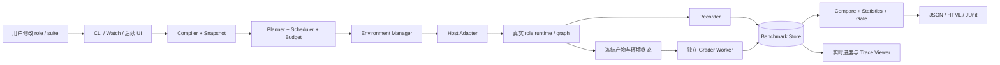

# Rolebox Benchmark 基建设计提案

状态：长期设计提案；dsh v1 的执行、报告、历史基线比较和基础 workspace 评测已实现，完整路线尚未落地。日期：2026-10-22。设计起点的仓库依据：`f6799da`。首发宿主：dsh。

当前实现包含 `rolebox bench init/validate/doctor/run/watch/report/baseline/compare`、可信本地进程隔离、独立 trial、role 快照、确定性文本/文件断言、可信本地命令评分、SQLite 记录和 JSON/HTML 报告。`init --template code-fix` 提供真实小型代码缺陷、工作区 fixture 和独立 checks；fixture/checks 冻结并参与 suite digest，执行结束先采集产物，再为每个评分命令单独复制产物与 checks。报告保留文件前后证据和命令输出，baseline 同时保存这些结果字段。checks 不出现在初始模型工作区，但当前 OS 权限隔离不足以保证答案保密，运行生成代码也需要信任。基础 watch 支持内容变化后去抖、取消旧版本并等待清理、无效配置修复后恢复，以及保留过时结果。baseline 保存不可变历史结果并保留名称修订；run/watch 可固定基线，只有当前、完整且已知条件可比的结果才输出差值。历史比较没有显著性或因果结论，watch 尚无累计费用预算。可执行命令、v1 schema 与能力边界以 [Benchmarks on dsh](benchmarks.md) 为准。

本文其余配置、`rolebox/benchmark` SDK、完整 watch 分层与预算策略、配对实验及统计比较、CI gate、容器隔离、replay 与完整宿主依赖锁仍是设计方向；不能将本提案的完整示例视为当前已支持接口。

## 1. 核心决策与适用范围

建立一个 **以真实 role 执行为被测对象、支持用户自定义任务和评分器的本地优先评测系统**。Rolebox 负责可靠执行、隔离、记录、比较和展示；benchmark 作者负责定义“什么任务值得测、什么结果算好”。

用户修改 role 后应能回答四个问题：哪些任务变好了，哪些退化了，提升是否足够稳定，以及为此多花了多少时间和费用。结果页以任务成功率、关键约束、成本、时延和失败样例为中心；不同业务的质量维度由 suite 自己定义。

本方案的初始规模假设是个人开发者或小团队：每套 20–200 个 case，1–5 个候选配置，每 case 1–10 次试验，单机 1–8 个并发 trial。它们是设计输入，不是性能承诺。先提供进程内协调器、独立执行进程和本地存储；远端 worker 和团队服务在实际容量需求出现后接入相同协议。

决定架构的原则：

1. **测真实行为**：同一 role 在实际宿主中的加载、工具、权限、子代理、hooks 和 memory 语义必须保留。
2. **结果可追溯**：每个分数必须能追到 case、不可变配置、执行记录、评分器版本和证据。
3. **反馈分层**：静态检查、开发 smoke 和正式回归承担不同任务；持续显示进度不等于实时得出统计结论。
4. **失败不掩盖**：语义失败、基础设施故障、评分故障、取消、预算终止和能力缺失分别记录。
5. **扩展有边界**：用户能定义数据集、环境、场景、评分器和报告器，但扩展不能自行篡改运行状态、预算或历史分数。

首期围绕 dsh 交付命令行、SDK、静态 HTML 报告和 watch。dsh 内嵌评测面板随后复用相同查询模型；其他宿主在 dsh 的完整闭环稳定后接入。暂不依赖托管平台，也不建设公共排行榜或自动修改 prompt 的优化器。

## 2. 仓库现状与接入策略

| 已有能力 | 依据 | 评测中的用法与边界 |
|---|---|---|
| role 发现、递归子代理、skills/functions/references 解析 | `src/loader/role-loader.ts`、`src/resolver/orchestrator.ts` | 复用解析规则，新增依赖清单与内容快照；不能只 hash `role.yaml` |
| prompt 组装 | `src/prompt/builder.ts` | 记录生成内容及来源；仅调用 builder 不能代替完整宿主运行 |
| session port | `src/platform/ports/session-client.ts` | 包装 create/prompt/messages/children/abort；新增评测适配器协调完整生命周期 |
| 宿主能力声明 | `src/platform/capabilities.ts` | 作为预检输入；增加评测专属能力探测及实际合约测试 |
| graph 的执行、结算、预算与恢复 | `src/graph/host/`、`src/graph/outcome/`、`src/graph/store/` | team case 内部继续使用真实 graph runtime；外部 suite 不包装成一个 graph |
| message/tool/token/cost 类型 | `src/session/types.ts` | 作为观测来源之一；未上报字段保留 unknown，单独标记完整性 |
| role 热加载 | `src/platform/adapters/dsh/rolebox-reload.ts`、`src/core/services/hot-reload-service.ts` | dsh reloader 会原地更新共享角色状态；bench watch 独立冻结版本，不在运行中替换 role |
| CLI、monitor、日志 | `src/cli/main.ts`、`src/cli/commands/monitor/` | 增加 bench 命令和独立读模型，不从日志文本推导正式成绩 |
| memory 存储 | `src/memory/store.ts`、`src/utils/state-paths.ts` | 每个 trial 使用独立 workspace/state root，禁止隐式读写开发者日常 memory |

现有 `EventBus` 会捕获并记录 handler 异常，不向调用方传播（`src/core/event-bus.ts`）。它可以用于 UI 通知，不能直接作为正式评测记录已经持久化的保证。

新增 `BenchmarkHostAdapter`，围绕既有 host composition 构造独立 runtime。保留宿主真实的角色激活与执行路径，不另写一套近似的 agent loop。现有 session port 不提供完整的启动、静态依赖冻结、隔离与终止确认，不能把它直接当成评测 runner。

具体编译入口优先采用 `src/resolver/bootstrap.ts` 的 `bootstrapRoles` 与 `src/platform/factory.ts` 的 `initializeRoleboxRuntime`。dsh 执行配置沿 `src/entries/dsh.ts` 的正式组合链，通过 registrar、role switcher、system-prompt adapter 与工具策略生效；未来 OpenCode 适配器再沿其 `buildAgentConfig` 路径集成。新增 strict diagnostics：目标 role 被跳过、依赖缺失、model override 未生效时拒绝运行，不能静默退回默认角色。适配器需在首个任务输入前返回实际 role ID、配置摘要、工具/权限和模型路由的激活回执，核对 requested 与 effective 配置；缺失关键回执即预检失败。`ISessionClient` 的空数组/null fallback 不能被解释为“读取成功但无消息”。

计量接入也不能直接复用 monitor 数字：部分宿主的 canonical message 尚未映射 usage/cost；现有 dispatch sampler 读取累计消息后交给累计式 tracker，存在重复计算风险（`src/dispatch/budget/budget-sampler.ts`、`src/dispatch/budget/budget-tracker.ts`）。graph 提供 reserve/reconcile 原语，但不代表所有 host 已接入完整 usage。benchmark 需要独立 `UsageObservation` 契约和去重测试；这些是前置能力缺口，不在本次设计任务中顺带修改。

首发固定为 **dsh**，由 `DshBenchmarkHostAdapter` 建立第一套适配器契约。P0 重点验证完整 profile 的 headless 启动、顶层角色激活、执行终态、子代理资源回收和计量入口。通用能力表中的 `hasSessionAbort: false` 表示 session port 不提供取消，并不表示 dsh 没有专用执行取消能力；两者需要分别验证。

| 宿主 | 当前集成对设计的影响 |
|---|---|
| dsh（首发） | 复用角色激活与 graph 集成；专用取消路径要确认终态，新增顶层运行与 usage 契约 |
| OpenCode（后续） | v1/v2 有不同能力，不能只按共同 `platformId` 缓存或比较；分别通过同一套适配器合约 |
| Pi（后续） | 有专用 worker 路径，但通用能力声明没有 session create；adapter 应接入实际 worker 路径 |
| Codex | 当前 rolebox 主要是 MCP 工具接入，没有完整 role/session/graph 执行入口；不能声称已经支持原生 role benchmark |

Codex 或其他宿主未来可以增加独立 headless driver。只做 prompt 调用的适配器必须标记为 `prompt-only`，不与 `native-role` 的结果混为同一种评测。执行记录回放标记为 `replay`，它验证评分器或展示，不证明修改后的 role 表现。

### 2.1 dsh 首发的具体执行路径

拟议路径：`bench coordinator → 独立 dsh host → 顶层 session/live Agent → 激活指定 role → 提交 case → 观察顶层及后代 → 冻结产物 → grader`。headless 指无交互 UI，不是缺少 agents/subagents 等服务的 minimal profile；具体启动 API 在 P0 用当前安装版本验证。

| 接入面 | 现有入口与首期要求 |
|---|---|
| 启动与装载 | `src/entries/dsh.ts` 使用 `initializeRoleboxRuntime` 和 `DshAgentRegistrar`；bench profile 必须挂载实际执行需要的 services，冻结 profile/包版本，禁止忽略 role 解析失败 |
| 顶层 role 激活 | `role-switcher.ts`、`active-role-store.ts`、`system-prompt.ts`、`role-tool-policy.ts`；使用正式 per-session 激活路径，任务输入前确认有效角色、模型与工具策略 |
| 子代理与 graph | `outcome-dispatch.ts`、`graph-worker.ts`、`graph-observation.ts`；沿真实 parent Agent 和 graph worker 边界执行，记录父子关系，不由 benchmark 伪造 graph 结算 |
| 终止与取消 | 顶层 Agent 的停止能力需单独核验；graph worker 优先复用 `DshOutcomeDelivery.cancelExecution` 的 requested/confirmed 语义，超时仍不确认时由隔离进程边界回收 |
| trace 与 usage | 保留 dsh 原始事件的 session/turn/call 关联；终态依据实际 turn/result，独立增加用量观察入口，不能从 canonical `session.idle` 或当前 monitor 推导完整账单 |
| 版本与状态隔离 | 每 attempt 独立 dsh host、profile/config/data/session/workspace 与 rolebox state；隔离 active-role sidecar、memory、工具服务状态，关闭 reloader 与宿主 HMR |

顶层 role 与 graph worker 是不同被测入口。graph worker 使用 one-shot 合约和受限工具面，不能仅调用 `startActivation` 跑一个 worker 就声称覆盖了用户日常顶层 role。首期以 `entrypoint: primary-session` 为主要任务形态；后续若支持直接评测 subagent/graph worker，必须另设显式 entrypoint、匹配的上下文和比较组。

dsh 的 provider 路由在日常运行中可能回退为继承路由（`agent-registrar.ts`）。benchmark strict 模式必须记录实际生效的 provider/model；未声明的回退使 target invalid，不能把配置里的模型名当作真实调用结果。

顶层模型绑定是明确的 P0 核验项：`DshRoleSwitcher.activate` 更新 per-session role holder，system-prompt adapter 注入角色内容；registrar 中的模型覆盖属于 spawn composition，不能据此证明顶层 Agent 已切换模型。顶层与子代理分别记录实际路由；示例中的 `modelPolicy: resolved-role` 若无法在顶层验证其声明的模型映射，则 target invalid，需要先补齐正式宿主路径或显式选择另一实验配置。

角色配置中存在某个字段，不等于 dsh 顶层已实现相应行为。例如 `system-prompt.ts` 明确当前同步 provider 未注入异步 memory，`role-tool-policy.ts` 提供的是 computer-use 专用策略；不能据此推断通用权限或全部 memory 语义已生效。P0 逐项核验顶层与子代理的模型参数、工具权限和上下文，能力不足时将依赖该能力的 case 判为 unsupported。benchmark 不额外补入日常 dsh 没有的行为来抬高成绩；需要补齐宿主集成时作为独立运行时改动验收。

graph worker 已有基于 run handle 的取消及终态确认（`outcome-dispatch.ts`）；旧 dispatch 的本地 cancelled 状态和 `dispose()` 调用本身仍不等于整个 trial 已停止。适配器必须连同顶层 Agent、后代和工具进程一起检查。原生事件或 provider 响应无法证明的 token/cost 保留 unknown，费用硬门禁在能力补齐前不可启用。

首批验收用例包括：固定回答、受控文件修改、一个真实顶层 role 发起的双节点 graph，以及超时/取消、用量缺失、连续编辑角色等异常场景。graph case 在 P0/P1 验证底层执行闭包，通用团队 benchmark 模板与指标可在 P3 完善。

## 3. 用户的完整工作流

拟议命令：

```sh
rolebox bench init review-quality --template code-review
rolebox bench validate benchmarks/review-quality
rolebox bench doctor benchmarks/review-quality --host dsh
rolebox bench test-graders benchmarks/review-quality

rolebox bench run benchmarks/review-quality --profile regression
rolebox bench baseline set review-quality --run <run-id>

rolebox bench watch benchmarks/review-quality --baseline review-quality
rolebox bench run benchmarks/review-quality --profile regression --baseline review-quality --comparison fresh-paired
rolebox bench compare <baseline-run-id> <candidate-run-id>
rolebox bench report <run-id> --format html
rolebox bench gate <comparison-id>
```

`init` 生成能读懂的三个示例 case、评分说明和配置；`validate` 只做数据/schema/引用校验，不执行用户扩展或发出模型请求；`doctor` 检查环境与适配器契约，任何付费探测需要显式 `--live`。`test-graders` 使用好、坏、边界答案验证 grader，可完全离线运行。

baseline 是指向不可变 run 的具名引用，只在显式设置时移动。watch 不自动把上一轮结果提升为 baseline。CI 必须 pin baseline run ID，不能在同一命令中重写基线。

历史结果对比标记为 `historical`，用于开发趋势观察。正式 `fresh-paired` 比较从基线来源重建目标，与 candidate 在同一计划中重新执行并随机交错；生成的 comparison 同时记录基线来源 run 与本次基线重跑 run。两侧使用相同且冻结的非实验条件，成本估算包含两侧执行；若宿主/模型协议已经变化，显式创建新的比较协议并记录来源，不改写原 baseline。历史结果不能冒充本次交错实验，也不作为默认严格 gate 的依据。

最终报告至少包含：本轮运行条件、与基线的差异、各维度指标和不确定性、各类状态计数、切片表现、逐 case 对比、可打开的证据和本轮总费用。支持 JSON 供机器处理、JUnit 表达门禁结果、HTML 供人阅读；导出的成绩包附带 manifest 和 digest。

示例用户体验（数字仅为示意）：

```text
review-quality · smoke · role revision 8ac… · baseline run-017
已完成 7/10；执行中 2；排队 1；本轮费用 $0.18（估计）
格式约束 7/7；问题召回 0.76；误报率 0.12
新增失败：review-004；恢复通过：review-009
费用观测覆盖 7/7；工具轨迹覆盖 7/7
当前为开发子集，尚未生成正式回归结论。
```

## 4. Benchmark 作者的模型

核心对象必须固定语义，避免将重复试验、执行重试和 agent 自我修复混为一谈。

| 对象 | 定义 |
|---|---|
| `Suite` | 一套版本化的评测目标、case、环境、评分与门禁规则 |
| `Case` | 一个稳定 ID 的任务；包含可见输入、fixture 引用、标签和私有 oracle 引用 |
| `Target` | role 及其完整依赖、宿主、模型、工具与权限配置 |
| `Scenario` | 单轮、多轮、环境交互或团队协作的驱动规则及终止条件 |
| `Run` | 一次冻结的 suite × target 矩阵与执行计划 |
| `Trial` | 某 case × target × repetition 的一个逻辑试验；默认独立初始状态 |
| `Attempt` | trial 因可恢复基础设施错误而产生的执行尝试；有独立 attempt ID |
| `Score` | 针对一份执行产物，以某个 grader revision 得出的不可变评分 |
| `Comparison` | 两组兼容结果及其统计比较；记录纳入/排除的 case 和原因 |

agent 在一个 trial 内部的反思、repair loop、subagent retry 属于被测行为，计入质量、费用与时延；不能在 benchmark 层悄悄变成免费重试。

### 4.1 三类任务共用协议

| 类型 | 输入与产物 | 典型评分 |
|---|---|---|
| response | 提问、文档、结构化输入 → 回复/结构化输出 | schema、事实核对、引用、rubric |
| workspace | 固定仓库/文件 → patch、命令、文件状态 | 隐藏测试、行为断言、修改范围、产物质量 |
| scenario/team | 多轮用户、工具服务或 graph 目标 → 完整交互与环境终态 | 任务完成、约束遵守、协作结果、成本、恢复能力 |

trajectory 指标用于解释原因，也可表达必要约束；不默认要求“必须按某个工具顺序执行”，否则会惩罚合法的更优解。

### 4.2 推荐目录

```text
benchmarks/review-quality/
  suite.yaml
  cases.jsonl
  fixtures/                 # agent 可见的输入
  private/                  # oracle、隐藏测试、rubric；不挂载到 agent
  graders/                  # 可选扩展及 grader 自测
  scenarios/                # 可选的多轮驱动
  README.md                 # 测量目标、标签、局限、复现步骤
  benchmark.lock.json       # resolved 依赖、版本与摘要
```

目录名 `private/` 本身不构成隔离。runner 只向 agent 导出允许的文件；完整 benchmark 源目录不得出现在 agent 可读挂载或宿主工具可访问路径中。

case 文件采用 JSONL，便于按行诊断、流式读取和 diff。YAML 负责声明，TS SDK 负责复杂扩展。后续支持 CSV/外部 dataset importer，统一编译成相同 `Case` IR，不增加第二套执行语义。

### 4.3 配置示意

以下展示拟议 schema 的方向；实施时以发布的 JSON Schema 为准。数值只是起始策略，不是统计有效性的保证。

```yaml
schemaVersion: 1
id: review-quality
description: 找出真实缺陷，控制误报，并给出可验证的修复建议

targets:
  candidate:
    role: ../../rolebox/code-reviewer
    host: dsh
    mode: native-role
    entrypoint: primary-session
    modelPolicy: resolved-role

dataset:
  source: cases.jsonl
  privateRoot: private
  splitField: split

scenario:
  kind: single-turn

environment:
  kind: container
  image: fixtures/review-image.lock.json
  network: fixtures-only
  memory: empty
  userInteraction: scripted-only

graders:
  - id: output-shape
    kind: json-schema
    schema: private/output.schema.json
    required: true
  - id: defect-coverage
    kind: extension
    module: graders/defect-coverage.ts
    export: grade
    required: true

metrics:
  primary: task_success
  taskSuccess:
    allRequiredGradersPass: true
    executionTermination: completed
    noPolicyViolations: true
  slices: [language, difficulty, defectType]
  report: [precision, recall, duration_ms, total_cost]

profiles:
  smoke:
    split: dev
    selection: fixed-stratified
    maxCases: 8
    repetitions: 1
    concurrency: 2
    limits:
      trialWallTimeMs: 120000
      runWallTimeMs: 300000
      runCostUsd: 1
  regression:
    split: regression
    selection: all
    repetitions: 5
    concurrency: 4
    limits:
      trialWallTimeMs: 300000
      runWallTimeMs: 3600000
      runCostUsd: 20

comparison:
  experiment: prompt-and-skills
  controlledChanges: [role.instructions, role.skills]
  pairedBy: caseId
  confidenceLevel: 0.95
  primaryNonInferiorityMargin: 0.02
  requireComplete: true
```

`image` 文件引用的是不可变镜像 digest；compiler 校验锁文件。`resolved-role` 保留 role 与子代理各自的真实模型路由，允许显式 override，但必须作为 target 差异记录。容器的 fixtures-only 网络针对工具业务流量；模型请求经独立 runner/provider 通道发送，所需访问由适配器预检。

`controlledChanges` 比较的是展开后的有效维度；compiler 追踪 instructions/skills 到生成 prompt 的派生变化，同时校验模型、权限、工具等其余维度未变。用户也可声明 `full-role-package` 实验，显式列出要改变的维度；此时报告为整体配置比较，不归因于单独 prompt。不能放行一个父级 snapshot 字段来隐式放行全部配置变化。

case 示例：

```json
{"id":"review-001","split":"dev","input":{"prompt":"审查这个补丁，报告可复现的正确性问题。","fixture":"fixtures/review-001"},"oracleRef":"private/review-001.json","tags":{"language":"typescript","difficulty":"medium","defectType":"boundary"}}
```

compiler 把 agent-visible input 与 grader-only oracle 分成不同消息/存储访问视图。`task_success` 的合成规则须在 suite 中声明或由模板显式生成：例如所有 required grader 通过且关键约束无违规。权重、阈值、缺失值策略均随 suite 版本冻结。

## 5. 组件与关键数据流



部署单元：一个本地 coordinator 拥有调度和数据库写入；独立 host worker 执行试验；独立 grader worker 评分；可选容器隔离环境。首期无需常驻服务，watch 进程即 coordinator，report 命令可离线读取历史结果。

| 模块 | 职责 | 不承担的职责 |
|---|---|---|
| Compiler/Snapshot | schema、引用、依赖闭包、能力需求、不可变计划 | 调模型、执行自定义 hook |
| Scheduler | trial 排队、并发、配额、deadline、取消和恢复 | 把 agent 的失败改判成成功 |
| Environment | fixture materialize、reset、snapshot、dispose、外部服务模拟 | 解释业务评分标准 |
| Host adapter | 启动真实宿主、绑定 role、驱动输入、采集输出、终止确认 | 实现第二套 role/graph 规则 |
| Recorder | 标准化事件、来源、完整性与持久化 | 依靠自由文本日志猜测成功 |
| Grader engine | 隔离运行评分器、校验评分、保存证据 | 修改被测 workspace 或历史成绩 |
| Comparison engine | 可比性检查、聚合、统计、门禁 | 在不兼容实验间强行产生提升百分比 |
| Reporter | query、流式进度、case 对比与导出 | 作为权威状态存储 |

扩展协议用声明式 manifest 描述 API version、entrypoint、能力需求和输入输出 schema；实现代码显式加载到 worker。`validate` 无副作用，`run` 才执行扩展。

概念接口如下，具体 TypeScript 签名在实现阶段确定：

```text
HostAdapter:
  capabilities() -> CapabilityReport
  prepare(frozenTarget, environment, executionPolicy) -> PreparedTarget
  execute(preparedTarget, visibleCase, scenario, eventSink, abortSignal)
    -> ExecutionArtifact
  cancel(executionId) -> TerminationReceipt
  dispose(preparedTarget) -> CleanupReceipt

Environment:
  prepare(fixtureDigest, isolationPolicy) -> EnvironmentHandle
  snapshot(handle) -> ImmutableEnvironmentArtifact
  dispose(handle) -> CleanupReceipt

Grader:
  grade(readonlyExecutionArtifact, privateOracle, graderConfig, abortSignal)
    -> ScoreRecord
```

grader 返回 `metricId / value / unit / direction / verdict / evidenceRefs / reason / revision`，其中 verdict 包含 `pass / fail / abstain / error`。`error` 与 `abstain` 不是 0 分；required grader 无有效结果时，trial 的评测状态为 incomplete，不能通过 gate。

## 6. 复现、隔离和执行语义

### 6.1 冻结的不只是配置文件

每次 run 编译出 manifest，至少包含：

- suite、case 内容、split、抽样清单与抽样 seed、grader/scenario 代码及依赖摘要。
- 完整 role 依赖闭包：递归子代理、skills 及附属资源、references、functions、hooks、extensions、公共 agent 目录等实际可达资源。
- 解析后的 role 配置与组装 prompt、工具定义、MCP 服务配置的非敏感部分、权限策略、compaction/重试策略。
- rolebox 版本或开发构建摘要、宿主包与适配器版本、请求的模型标识及已知版本、generation 参数。
- fixture digest、仓库 revision 或显式选入文件快照、依赖锁文件、镜像 digest、OS/架构、locale/timezone、初始 memory、环境变量白名单的非敏感值。
- 外部网络模式、服务版本或回放数据集版本、资源限制、价格表版本、能力探测结果和观测完整性。

必须**物化快照并从快照运行**，不是 hash 后继续读取正在修改的文件。动态目录发现无法静态枚举时，冻结允许访问的资源全集；无法固定的外部依赖标为 live，降低复现等级。不要把凭据值写入 manifest 或普通 hash 输入。

现有 env resolver 可以将环境变量展开到配置，因此不能直接序列化全部 resolved config。公开/持久 manifest 保存秘密引用与非敏感版本标识，运行时通过受控通道注入。物化前检查已知秘密来源和敏感文件策略；发现内嵌凭据时拒绝直接封存，要求改为运行时 secret overlay。扫描只是辅助，真正边界仍是允许纳入的文件/字段清单。包含秘密的实际内容只在受保护执行上下文使用；无法安全保存的配置标为 opaque，记录这一复现限制。可分享视图与内部执行快照使用不同 schema、权限与保留策略；不能静默删改输入后仍声称原样复现。

每轮执行记录可见输入与实际运行快照的关联；执行后才获得的模型请求 ID、提供方实际版本、缓存命中等写入 execution receipt，不回写预先冻结的 manifest。宿主不暴露全部系统注入时如实声明 opacity。提供方 seed、固定温度、模型名称都不构成逐 token 可复现保证。

三个复现等级分别为：`artifact-replay`（重读已有产物/重评分）、`controlled-rerun`（冻结可控输入并重新运行）、`live-environment`（保留外部环境差异）。报告永远显示等级。

### 6.2 隔离矩阵

| 资源 | 默认策略 |
|---|---|
| 会话/进程 | 每 trial 新会话；首期独立 host 进程，避免模块级 registry/缓存污染 |
| 文件系统 | 每 trial 的 fixture 副本；正式 workspace benchmark 默认容器或等价沙箱 |
| memory/state | 独立 state root，默认为空；指定 memory seed 时只读复制，结果不回写 seed |
| 子代理 | 继承 trial 边界，记录父子关系，共享该 trial 的预算；不同 trial 不共享 session |
| 工具与网络 | 默认受控 fixture/mock；live 测试单独 profile、单独报告 |
| oracle/隐藏测试 | 不交付 agent；结束后冻结产物，在独立 grader 环境中注入 |
| 用户交互 | 使用明确脚本或版本化 simulator；无人值守运行不等待真实审批 |
| 凭据 | 单独 allowlist/受控注入；不继承完整开发环境；不进入 trace 和产物 |

临时目录、Git worktree、子进程都只能解决部分状态污染，不能限制文件读取、网络或任意 shell。需要保密 oracle、运行第三方 benchmark 或不受信任代码时，必须使用实际权限隔离。隐藏测试执行也可能运行 agent 生成的代码，grader 容器同样需要限制网络与宿主访问。

可信评分控制器持有 oracle 主副本、评分规则和 ScoreRecord 写权限；被测代码运行于单独受限单元，结果由可信 test adapter 收集。agent 可写的 JSON/JUnit/日志只能作为待验证产物，不能直接作为权威成绩。语言内单元测试可能与被测代码共享进程，无法防止所有自省/伪造；此类 grader 必须声明限制，不能宣称防作弊。更强要求使用外部行为测试、独立服务边界或 VM，仍由外部控制器确定分数。

隔离还必须覆盖 host home/config/data/cache/temp/session roots。dsh 首期使用独立 host profile、工作目录、active-role sidecar 与 memory/state；不能连接用户正在使用的 dsh 实例来做有副作用的试验。trial 内关闭 dsh reloader 与宿主 HMR，原生 profile 的相关控制需在 P0 验证；现有 `ROLEBOX_HOT_RELOAD=false` 可用于 rolebox reload 开关，但不能假定它同时约束宿主 HMR。由外层 watch 生成新版本，所有 symlink 只能指向冻结副本。后续接入 OpenCode 还要覆盖其基于 home 的 agents 路径和 skills 链接清理，不能仅重定向 XDG 目录。

电脑操作任务需要独立 VM/桌面会话和重置机制；不能把用户当前桌面当作可复现、可并发的 fixture。首期没有这种能力时拒绝该类 case，并说明缺失能力。

多轮场景使用有界状态机；固定最大 turns、结束条件与用户响应脚本。使用模型模拟用户时固定 simulator 版本，单列费用，并以人工抽查校验其真实性。长期 memory 评测将完整 episode 视为试验单位，episode 内可持续记忆，episode 之间重置。

### 6.3 状态与恢复

执行阶段：`planned → preparing → running → collecting → executed`。

评分阶段：`pending → grading → graded`。

执行终止原因单列：`completed / task_timeout / budget_exceeded / policy_violation / infra_error / cancelled / unsupported / interrupted`。评分终止原因也单列。业务通过与否是评分结果，不能用执行进程 exit 0 或 graph 完成状态代替。

关键约束：

- 每个事件包含 run/trial/attempt、producer ID、递增序号、时间和来源；重复接收以稳定 event ID 去重。
- coordinator 是数据库单写者，worker 通过带确认的事件通道提交；worker 保留有界 spool，写入失败时暂停/终止并标记 incomplete，不静默丢事件。
- 每 attempt 有 lease/generation；晚到事件保留用于审计，但不得覆盖后续 attempt 或已经冻结的 terminal 结果。
- 崩溃后能复用已提交的执行产物继续评分；运行中的外部请求不能假定“没有发生”。
- 只有明确可恢复的基础设施错误可触发 retry；在确认旧进程与后代已停止、重置环境之后创建新 attempt。保留所有尝试与费用，不能挑最好的一次。
- 原模型调用或外部写操作是否完成无法确认时，标记 interrupted/ambiguous；不承诺 exactly-once，不默认重放 live side effect。
- 取消必须穿透宿主、子代理和子进程；只有收到停止确认或进程树已被回收，才释放资源槽位。无法确认时隔离该 worker，不以“已发出 abort”冒充停止。

一个 trial 最多有一个权威 execution artifact：唯一有效当前 generation 通过 collecting 校验后，事务性提交 artifact 引用并关闭自动 execution retry。此前失效 attempt 的产物仅保留审计，不参与择优。grader error 不允许重新运行 agent；grader retry/regrade 使用独立 grading attempt ID，消费同一冻结 execution artifact。自动基础设施重试的错误白名单、次数上限和退避策略在计划中预先冻结。

### 6.4 预算是执行约束

预算包括 wall time、turns、tool calls、tokens、费用、子代理数、artifact 大小与磁盘占用。suite 总预算涵盖所有 target、重复试验、失败 attempt、grader 和 simulator；同时分列 agent 与评测开销。

并发启动前预留资源，结束后按实际用量结算；未知 usage 不按 0 退回。宿主没有实时 usage 或可靠停止能力时，不能宣称有严格美元硬上限。严格 profile 必须有可执行的请求级限额/代理计费控制，否则预检拒绝；普通 profile 显示估计上限与可能的在途超支，并用时间/请求数等可执行约束兜底。

## 7. 评分体系与统计可信度

### 7.1 多维成绩，关键条件独立判断

| 维度 | 示例 | 推荐来源 |
|---|---|---|
| 任务正确性 | patch 隐藏测试通过、问题召回/精确率、环境终态 | 确定性 grader、环境断言 |
| 约束遵守 | 只读任务未修改文件、没有越权操作、指定格式成立 | 工具/环境证据、schema |
| 产物质量 | 可读性、论据充分、设计完整性 | rubric judge + 人工校准 |
| 执行效率 | tokens、费用、执行时长、工具数 | 宿主计量 + recorder |
| 稳定性 | 同一 case 重复试验成功比例、不同切片退化 | 统计引擎 |
| 恢复能力 | 注入工具失败后仍完成任务、repair 次数 | 版本化故障注入场景 |

required 约束优先判断，避免“答案漂亮”抵消越权操作。若 suite 定义综合分，必须展示公式、权重和各分项；不同 suite 的综合分不可直接横向排名。

### 7.2 评分器也必须被验证

提供 exact/normalized match、regex、JSON Schema、数值容差、文件差异、受限 command test、环境终态、trajectory predicate、rubric judge、pairwise judge 与人工评分等扩展点。首期实现常用确定性 grader 和自定义 worker 协议，judge 后续接入同一机制。

每个 grader 带正例、负例、边界例与对抗例；检测永远满分、空输入通过、证据不存在、值越界等错误。代码测试必须有真实行为断言，不能只检查 agent 是否说“测试已通过”。

LLM judge 固定模型路由、rubric、模板和 generation 参数，保存结构化 verdict、简短理由与证据引用。被测输出作为不可信数据处理，不交给 judge 工具执行。参考答案与 target 身份分离；pairwise 比较随机化顺序、允许 tie/abstain，并在校准集中做顺序互换审查。高风险或低一致性样例进入人工复核。

不能把 judge 自报 confidence 当成校准置信度，也不能把多个 grader 的分歧简单平均掉。grader/rubric 改变产生新 score revision；基线和候选应对同一 grader revision 重评分，旧分数保留。

### 7.3 重复试验、分母和不确定性

正式比较以稳定 case ID 配对，先在 case 内聚合重复试验，再按冻结权重跨 case 聚合；相同 repo/episode 的相关 case 使用更高层 cluster。主指标与关键切片在执行前声明。

完整运行的主指标定义为 `case_success_rate = Σᵢ wᵢ × (Σᵣ yᵢᵣ / Rᵢ)`，其中 `Σᵢ wᵢ = 1`，`Rᵢ` 是该 case 的计划试验数，`yᵢᵣ` 是确定的成功 1 / 失败 0。权重在计划中冻结，默认每 case 等权。另报 `trial_success_rate = Σᵢᵣ yᵢᵣ / Σᵢ Rᵢ`；两者不可混用，例如两个 case 分别 1/1 和 0/9 时，等权 case 成功率为 50%，trial 成功率为 10%。

基础输出至少有：planned、attempted、executed、validly-scored、task-failed、infra-error、grader-error、unsupported、cancelled 和 unknown 计数。报告同时显示：

- 质量估计：完整时按上述公式；缺失时主指标为 unknown，可另显示 provisional 条件估计：每 case 对有效 trial 求均值，仅在有有效 trial 的 case 上按原权重重新归一。同步显示有效 case 的原始权重覆盖及各 case 的 valid/planned 数。
- 计划交付率：全部预定 trial 中有效完成评分的比例。
- 保守完成成功比例：预定 trial 中已证实成功的比例，单独标记为运行交付指标。

超出事先声明的任务时间/行为预算属于任务失败；平台停机、观测故障、用户取消属于未完成，不混作质量 0 分。存在未完成试验时，质量结果注明条件性和缺失可能引入的偏差；严格 gate 要求完整计划，不能仅靠跳过失败 case 通过。

任务超时、策略违规等由预先声明的执行规则直接产生有效的 `task_success = 0`；因该终态而无需执行的产物 grader 标记 `not_applicable`，不把已确定的任务失败改成无评分样本。若连超时/违规证据都不完整，则仍为 incomplete。因 suite 总预算耗尽而未启动的 case 记为未完成，不能归责于该 case 的 role。

对二值独立样本可提供 Wilson 区间；对重复/相关 case 的 A/B 差值默认使用按 case（必要时 repo/episode）成簇的配对 bootstrap，并声明抽样假设。若同时估计同一 case 内执行随机性，采用分层 bootstrap；只有一个 case 的结果不能宣称覆盖整个任务分布。小样本输出“证据不足”，不要因为重复很多次就伪造大量独立样本。

回归起始配置可取 3–5 次/case，但样本量应根据实际方差、可接受退化幅度和预算调整。候选/基线执行顺序随机交错，控制时间段、并发、资源配额和外部环境；固定 seed 只是可记录的控制变量，不保证两个模型的随机过程完全配对。

区分三种量：`trial_success_rate` 衡量完整 trial 的成功比例，主指标另按 case 加权；`pass@k` 衡量 k 次中至少一次成功；`all-k-success` 衡量 k 次全部成功，只有适当独立性假设下才可用单次成功率的幂作概率近似。不可把挑选最佳样本当作可靠性提升。

### 7.4 可比性与 gate

构造 `comparisonFingerprint`：case 内容与权重、环境、场景、grader、非实验变量、预算、执行模式、宿主版本、观测覆盖等。允许不同的字段只来自预先声明的 treatment，例如 role revision；模型/宿主变化可以是明确的其他实验，但不能同时被解释成纯 role 改进。

数据集更新时只对共同且内容未变的 case 生成受限比较，并显示新增/删除/改变的 case；完整 gate 要求基线补跑。运行预算或工具权限改变会影响成功率，默认要求重新建立可比基线。

非劣门禁示例：主指标差值为 candidate − baseline，容忍下降幅度为 2 个百分点。置信区间下界 ≥ −0.02 才支持非劣；上界 < −0.02 表示退化；介于两者之间为 inconclusive。绝对硬约束可直接 fail。门禁最终输出 `pass / fail / inconclusive / invalid`，后两类在严格 CI 中也不得返回成功。

先检查数据完整性、观测能力和比较兼容性，再判断质量，最后单独判断成本/时延。p95 等尾部指标需足够样本；仅几次运行时显示原始分布，不包装成精确趋势。模型 usage 或计价缺失时费用为 unknown，费用 gate 不通过或明确未评估。

持续 watch 默认只做描述性比较；正式 gate 采用预先固定的试验计划。若未来加入自适应提前停止，需要成套实现顺序检验与多重比较控制，不能每完成一个 case 就重复检验并在“显著”时停下。

首期正式 gate 只接受一个预先指定的 candidate。多候选矩阵用于探索；选出最好候选后，使用独立确认运行/holdout。未来若要让多候选同时参与正式判定，必须声明并实现同时推断策略，不能先挑最高均值再按单一比较解释区间。

开发集用于反复调优，regression 集用于常规回归，holdout 集用于发布前评估；记录 case lineage 并防止同源样本跨 split。用户在自己机器上持有全部数据时，技术隔离只能减少执行时泄题，不能保证作者从未看过答案。对外可信测评需要独立持有的保留集。

## 8. 修改后快速反馈：watch 的具体语义

watch 监控 suite 和 role 的依赖闭包，包括 skills 附属文件、references、functions、子代理、fixtures 与 grader；输出目录、日志和数据库不在监控范围。

一次保存的处理流程：

1. 防抖并等待文件写入稳定，重新解析；语法/依赖错误立即显示，不花模型费用。
2. 为新内容生成 revision，物化不可变快照；当前执行不会读到一半新、一半旧的内容。
3. 标记旧 revision 为 superseded；停止尚未启动的旧任务，按配置让在途 trial 完成或确认取消。
4. 保留至多一个最新待运行 revision，防止连续保存累积昂贵队列；只有同 revision 的结果进入同一报告。
5. 运行固定的分层 smoke 子集；优先展示近期失败/受影响 case 时，额外样例单列，避免改变主比较分母。
6. 流式展示开始、完成、评分与证据；每条结果标记 revision、fresh/cached、观测完整性和所属 profile。

建议反馈层级：

| 层级 | 触发 | 内容 | 结论范围 |
|---|---|---|---|
| 静态检查 | 每次稳定保存 | schema、引用、能力需求、预算配置 | 配置是否可运行 |
| smoke | 显式启动 watch 后自动 | 5–10 个固定 case，通常一次重复，有严格运行预算 | 快速发现问题，方向性参考 |
| regression | 用户命令或配置好的 CI | 全量目标切片、多次重复、配对比较 | 指定任务集上的退化证据 |
| holdout/live | 发布前或显式计划 | 保留集、真实外部环境、人工抽查 | 泛化与外部有效性 |

UI 响应目标可设为本地小型 suite 保存稳定后 1 秒内显示静态状态、持久化事件后 500ms 内显示更新；这是待验证 SLO。模型执行时间不作秒级承诺，smoke 的超时会显示 partial/inconclusive。

watch 启动即确认本会话的自动运行范围和费用上限；后续保存不重复询问。达到额度后停止付费执行，但继续静态反馈。每个 suite 的并发上限再受全局 provider 配额约束，父 role 的子代理也占用实际资源配额。

缓存分三类：

- fixture/依赖缓存：按内容摘要复用，只读；每 trial 有独立可写层。
- execution 缓存：仅用于开发历史展示或显式 replay；repetition/attempt 身份不合并。正式性能与随机性评测默认 fresh。
- score 缓存：相同 execution artifact + oracle digest + grader revision 可复用；重评分不是新的 agent trial。

LLM 服务端 prompt cache 的命中属于真实计量条件，单独记录。不能把本地缓存命中的零时延/零新增费用混入 fresh trial 的性能统计。

## 9. 存储、事件与数据治理

推荐 SQLite 保存结构化事实与索引，文件系统保存按内容寻址的大对象。它适合本地单协调器查询、事务更新和离线报告；第一阶段不引入外部数据库。

```text
benchmark-store/
  benchmark.sqlite
  blobs/<digest>
  snapshots/<digest>
  exports/<export-id>/
```

实际默认存储路径由统一 path resolver 生成，远离被测 workspace 的可读挂载；不能只把数据库放到 agent 可访问的仓库隐藏目录就声称隔离。

主要表：`suite_versions`、`snapshots`、`runs`、`run_targets`、`cases`、`trials`、`attempts`、`events`、`artifacts`、`scores`、`comparisons`、`baseline_refs`。run 记录计划与统计策略，trial 存执行状态，score 只追加版本，baseline 更新保留审计记录。

事件体最低字段：`schemaVersion / eventId / runId / trialId / attemptId / producerId / sequence / occurredAt / receivedAt / kind / payloadRef / provenance`。session、subagent、graph/node/attempt 用关联 ID 链接；benchmark attempt ID 与 graph attempt ID 使用不同字段。

事件覆盖生命周期、role 绑定、消息、tool start/end、子代理、graph、usage、environment snapshot、grader 与预算变化。保留宿主可观察证据，不要求提供方隐藏推理。tool 参数/输出、模型文本和文件片段按敏感级别存储，可配置截断；truncate/redact 后需要的 grader 证据缺失时必须报 incomplete。

usage 带 provider/model、单位、来源、是否累计值、去重键及 `known / estimated / unknown`。按消息/调用唯一键汇总，避免根会话与子会话、累计账单与增量事件双重计费。记录 queue、prepare、execute、collect、grade 等阶段时长，agent 执行时延与端到端评测时延分别报告。

数据库事务提交 terminal state、事件和 artifact 引用；blob 先写临时文件并完成原子提交再引用，失败留下的孤儿 blob 由 GC 清理。启动时检查缺失 blob、未完成 attempt、schema 版本，不能静默把损坏记录当成成功。

本地默认不上传。共享导出使用独立 allowlist manifest，默认不导出原始 prompt、tool payload、环境变量、身份路径和 private oracle；附带脱敏及观测缺失说明。设置 artifact 大小上限、保留周期、磁盘告警和可预览的 GC。baseline 引用的最小成绩与配置证据必须受保护；删除后明确标记不可复现。

## 10. 用户如何构造高质量 benchmark

首批模板应覆盖代码修复、代码审查、资料研究、结构化提取、规划和多代理协作。模板提供可运行的 fixture、case、确定性 grader、自测、报告解释和局限说明，而不只是一个 YAML 空壳。

推荐作者流程：

1. 定义角色的真实任务和失败代价，选 1 个主指标、少量关键约束及成本指标。
2. 从真实任务抽样并脱敏，保留难度/语言/任务类型标签；加入边界、拒绝、无问题输入和工具故障样例。
3. 把任务输入与 oracle 分离。代码修复提供原始仓库和隐藏行为测试；代码审查同时标注真实缺陷与无缺陷样例，以检查召回和误报。
4. 用固定好/坏产物自测 grader；对 judge 先建立人工标注校准集，再评估其一致性。
5. 执行 baseline，检查失败样例是否反映真实质量；先修好 benchmark，再优化 role。
6. 划分 dev/regression/holdout，冻结版本和比较策略，再开始 watch 与 CI。

支持把历史 session 草拟成 case，但生成后必须由作者明确可见输入、oracle、fixture 与评分规则。不能直接把原 role 的回复当作 ground truth，也不能自动将生成数据送入 holdout。

可共享的 Benchmark Pack 包含 suite、公开数据、fixture 来源、扩展源码与依赖锁、许可证/数据使用说明、能力要求和结果解释。`pack/import` 检查路径穿越、摘要与 schema；导入时不自动执行脚本。能力不足时预检明确拒绝或显式排除，排除后显示覆盖缺口。

## 11. 工程落点与实施顺序

建议新增一个边界清晰的模块，避免让 benchmark 散落在 dispatch、TUI 与 host entry 中：

```text
src/benchmark/
  spec/           # schema、IR、编译、manifest
  snapshot/       # 依赖闭包与物化
  runner/         # trial 生命周期、调度、预算、恢复
  hosts/          # BenchmarkHostAdapter；首发 dsh，其他宿主后续接入
  environment/    # fixture、进程、容器、reset
  trace/          # 标准事件、完整性、usage
  grading/        # 内置 grader、扩展 worker
  compare/        # 可比性、统计、gate
  store/          # SQLite、blob、迁移、GC
  watch/          # 依赖失效与 revision 调度
  report/         # 查询、JSON、HTML、JUnit
  sdk/            # 公开的作者 API
src/cli/commands/bench/
tests/benchmark/
examples/benchmarks/
```

发布时考虑新增 `rolebox/benchmark` export，避免用户依赖内部路径；schema 与 SDK API 独立版本化。内置模板进入实际包内容，必须在最终打包产物上验证可导入、可初始化与可离线报告。

| 阶段 | 交付 | 必须满足的验收条件 |
|---|---|---|
| P0：验证 dsh 执行真实性 | 独立完整 profile、primary-session driver、激活回执、snapshot/隔离、usage 与取消探针 | 日常路径与 benchmark 路径使用一致 role/工具/模型；真实顶层 role 可派生 graph；确认停止及回收全部后代；能力缺失明确失败 |
| P1：dsh 最小可靠闭环 | schema/JSONL、DshBenchmarkHostAdapter、单轮与 workspace、独立状态、确定性 grader、SQLite、JSON/HTML | 自定义 suite 从 init 到 baseline/compare 全流程可用；保留失败/中断与未知用量；原 workspace/日常 dsh 状态不受污染；评分器可自测 |
| P2：修改即时反馈 | watch、依赖闭包失效、smoke、版本固定、预算控制、回归统计与 CI gate | 连续保存不会混用版本；共享 skill 变化触发相关 case；缓存不冒充新样本；incomplete 不返回成功 |
| P3：任务与交互扩展 | 多轮/episode、团队 graph 模板、judge 校准、dsh 评测面板、Benchmark Pack | 内嵌面板与 CLI 读取同一 run/score；oracle 隔离；全子代理成本/停止可验证；扩展与 pack 版本兼容 |
| P4：宿主与容量扩展 | OpenCode/Pi 等适配器、远端 workers、共享存储、团队报告 | 新宿主通过同一适配器合约；扩容由实际容量需求驱动；继续使用相同 trial/event/artifact 协议 |

P1–P2 是面向 dsh 用户“改 role 后可可靠评测”的首个完整产品闭环。P3 扩展任务种类并接入 dsh 内嵌交互，P4 再扩展宿主。每阶段可验收后独立发布，不把全部工作推迟到一个大版本。

验证策略：新增 `tests/benchmark/` 模块切片；具体 dsh seam 改动再选择对应测试，例如 `tests/dsh-plugin.test.ts`、`tests/dsh-dispatch.test.ts`、`tests/platform/dsh-role-switcher.test.ts`、`tests/platform/dsh-system-prompt.test.ts`、`tests/platform/dsh-graph-observation.test.ts`。按仓库政策执行 scoped tests 和 `npm run typecheck`，不在开发阶段跑完整套件。

需要的关键测试是：已知好坏产物的 grader 自测；缺失 usage 不变成 0；agent 无法读取 oracle；用户真实目录零写入；memory/case 顺序无污染；重复/乱序事件不重复结算；崩溃恢复与取消不遗留 worker；snapshot 在热编辑期间不漂移；基线不兼容时拒绝 gate；一组已知统计分布上的聚合/区间/分母测试。模型在线 smoke 独立显式运行，不纳入默认离线测试，也不依赖“模型这次刚好回答对”。

## 12. 关键取舍与后续验证

| 决策 | 获得 | 代价与复审条件 |
|---|---|---|
| Rolebox 自有 runner 协议，复用真实宿主 | 准确测量 role、graph、权限与 memory | 维护宿主适配器；需持续运行合约测试 |
| YAML + 稳定 IR + 可选扩展代码 | 简单任务容易写，复杂任务可扩展 | 需要 schema/SDK 迁移；避免把任意代码藏在声明加载阶段 |
| 本地 coordinator + SQLite/blob | 安装简单、离线可用、容易追溯 | 单机资源受限；容量或协作需求出现后接入远端 |
| smoke 与正式 gate 分离 | 修改时反馈快，结论口径稳定 | 用户需要理解“方向性反馈”和“统计证据”的区别 |
| 先确定性 grader，再扩展 judge | 可调试、成本可控 | 开放任务需要人工校准与模型评分 |
| 独立 trial 与严格快照 | 减少污染，方便比较 | 进程/环境启动开销较大；仅在隔离证明后引入安全复用池 |

实施前最值得做的验证依次是：宿主执行保真与终止、依赖快照覆盖、agent/grader 隔离、全子代理 usage 完整性。它们决定测量是否可信，优先级高于图表丰富度。

首发宿主已确定为 dsh。尚需产品侧选择：首批任务模板、默认 smoke 预算、正式回归的容忍退化幅度。这些采用本文默认值可以开始 P0，但需用实际用户任务校准。成本数字、用例规模、反馈 SLO 都是拟议默认，不是已经验证的服务承诺。

## 13. 外部参考

下列资料已核验；本文的模块边界、默认值和实施顺序是针对 rolebox 的设计判断。可借鉴其协议与产品经验，将导入/导出适配器作为后续扩展；不把它们设为核心执行的强制依赖。

| 来源 | 本方案借鉴或防范的要点 |
|---|---|
| [Inspect Tasks](https://inspect.aisi.org.uk/tasks.html) | 数据、执行和评分分离；Rolebox 自己保持真实 role 执行链 |
| [Inspect Sandboxing](https://inspect.aisi.org.uk/sandboxing.html) | 每个样本的独立环境；声明 sandbox 不代表任意扩展代码都被隔离 |
| [Inspect Scoring Workflow](https://inspect.aisi.org.uk/scoring-workflow.html) | 保存产物后可离线重评分；执行版本和 grader 版本独立 |
| [Inspect Metrics](https://inspect.aisi.org.uk/metrics.html) | 重复试验归约、分组指标与不确定性 |
| [Inspect Scoring Policy](https://inspect.aisi.org.uk/scoring-policy.html) | 区分被测模型失败、运行错误与无法评分 |
| [promptfoo CLI](https://www.promptfoo.dev/docs/usage/command-line/) | watch、过滤、重复执行和本地结果查看 |
| [promptfoo Caching](https://www.promptfoo.dev/docs/configuration/caching/) | repeat index 有独立缓存作用域，但再次运行仍可复用旧输出；fresh trial 必须显式保证 |
| [Anthropic：Demystifying evals for AI agents](https://www.anthropic.com/research/demystifying-evals-for-ai-agents) | agent 评测的任务、试验、轨迹、产物与评分结构；优先检查真实任务成果 |
| [Anthropic：Infrastructure noise](https://www.anthropic.com/research/infrastructure-noise) | 执行资源条件也会影响 agent benchmark 结果 |
| [Judging LLM-as-a-Judge](https://arxiv.org/abs/2306.05685) | judge 的位置、冗长和自我偏好等偏差，需要校准 |
| [τ-bench](https://arxiv.org/abs/2406.12045) | 多次完成同一任务的可靠性与至少成功一次的能力应分别衡量 |
